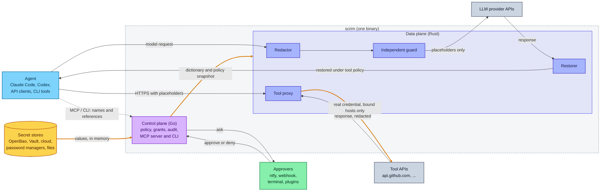

<h1 align="center">
  <picture>
    <source media="(prefers-color-scheme: dark)" srcset="docs/assets/scrim-dark.svg">
    
  </picture>
</h1>

<p align="center">
  Keeps secret values away from LLM providers while your AI agents keep working.
</p>

<!-- Badge lines are long; wrapping them helps nobody. -->
<!-- markdownlint-disable MD013 -->
<p align="center">
  <a href="https://github.com/heliopsy/scrim/actions/workflows/ci.yaml"></a>
  <a href="https://github.com/heliopsy/scrim/actions/workflows/openspec.yaml"></a>
  <a href="https://scorecard.dev/viewer/?uri=github.com/heliopsy/scrim"></a>
  <a href="https://github.com/heliopsy/scrim/releases/latest"></a>
  <a href="LICENSE"></a>
</p>
<!-- markdownlint-enable MD013 -->

scrim is a local proxy that replaces every known secret value in an agent's requests with a
placeholder before they reach the model provider, and puts the real credential back only on
connections to the hosts it belongs to.

This README describes scrim 1.0. What it does not protect against is in
[docs/limitations.md](docs/limitations.md).

## The problem

A coding agent reads `.env` files, config files, logs and command output, and everything it reads
becomes context for the next model request. A `cat .env`, a `kubectl get secret -o yaml` or a
verbose `curl` sends the values to Anthropic or OpenAI, and to every proxy and log in between.
Nobody decided to share them; the agent needed to see the file.

Taking the secrets away breaks the agent, which still has to call the GitHub API, push to a
registry or run a migration. scrim keeps the values off the wire to the model and lets the agent's
tools keep using them.

## How it works



Colours: blue is the agent, indigo the scrim data plane, purple the control plane, amber the secret
stores, green people and notifiers, grey the provider and tool APIs. Amber edges carry real secret values.

1. The control plane loads the secrets your configuration marks for redaction from the stores you
   already run and pushes them to the data plane. Values live in memory only.
2. Each outgoing model request is matched on its raw bytes against every known value and its
   encoded forms. Each match becomes a deterministic placeholder, `⟦scrim:<slug>:<hmac>⟧`, built
   from an HMAC of the value, so the same value always gives the same bytes and prompt caching
   keeps working.
3. A separate guard, sharing no matching code with the redactor, scans the exact bytes about to
   leave. If either check fails, the request is refused and nothing is sent.
4. Placeholders in the response are resolved where the tool policy allows. A credential is never
   restored into a command, file edit or tool argument. It stays a placeholder, and the tool proxy
   swaps in the real value only on connections to the hosts the credential is bound to.

Say the agent runs `cat .env` and the file holds `GITHUB_TOKEN=example-a71c90e2fb3d44c8`. In the
next request, the provider receives that tool result as:

```json
{
  "type": "tool_result",
  "tool_use_id": "toolu_01",
  "content": "GITHUB_TOKEN=⟦scrim:github:5f2a9c0d1e7b⟧\n"
}
```

The model answers with a command that uses the placeholder:

<!-- docs-test: skip: an agent's request as scrim sees it, sent to api.github.com -->

```sh
curl -H "Authorization: Bearer ⟦scrim:github:5f2a9c0d1e7b⟧" https://api.github.com/user
```

The agent runs the command as written. The request goes through scrim's tool proxy, which puts the
real token in because `api.github.com` is a host the token is bound to; toward any other host the
request is refused and audited. GitHub's answer comes back with any known value in it replaced
again. The agent's own transcript still holds the real line from `cat .env`, because the file was
read on your machine (see [What scrim does not protect](#what-scrim-does-not-protect)).

## Features

### Redaction

- Exact matching of known values on the raw request bytes, including their JSON-escaped, base64
  (standard and URL-safe, all three alignments), hex and URL-encoded forms.
- Deterministic placeholders with a versioned key. Placeholders made before a key rotation keep
  resolving.
- An independent guard over the exact outgoing bytes that decodes transforms the redactor does not
  attempt, then repairs or refuses.
- Fail closed: a redaction or guard error refuses the request. There is no unredacted fallback.
- Unknown request fields are redacted by default. Thinking blocks, signatures and encrypted
  reasoning pass byte-identical.
- Fallback detectors (pattern rules and entropy) for secrets no store knows about.
- Streaming restore that holds back at most one placeholder length per content block.
- Per-tool restore policy with escaping for shell, interpreter strings, SQL, JSON and YAML, and no
  restore where the output would itself become code.
- Anthropic Messages, OpenAI Chat Completions, OpenAI Responses and the Gemini API, streamed and
  not, as built-in routes. Amazon Bedrock (InvokeModel, Converse and Bedrock API keys), Claude
  Platform on AWS, Microsoft Foundry and Google Vertex AI as cloud routes that scrim signs or
  authenticates after redaction ([docs/providers](docs/providers/README.md)).
- Capture mode, which writes each request exactly as it left for the provider.
- Chaining through a context-compression proxy, with redaction first.
- Images, PDFs and other attachments are decoded and scanned, metadata and document text included,
  and a request whose attachment holds a secret is refused (`redaction.binary`; text in pixels is
  not read, see [docs/limitations.md](docs/limitations.md#redaction)). Attachments referenced by
  URL are fetched by scrim, scanned and sent inline (`redaction.remote-attachments`).

### Credential injection

- Each credential is bound to hosts. A placeholder sent toward any other host is refused and
  audited.
- An HTTPS tool proxy with its own CA. It substitutes in URLs, headers, cookies, forms, JSON and
  multipart bodies, handles compressed bodies and fixes lengths and digests after substitution.
- Three placeholder kinds: generated ones, declared ones (`SCRIM_GITHUB_TOKEN`) for hand-written
  config files, and reference placeholders (`{{scrim:bao://kv/agents/github#token}}`).
- Tool API responses are redacted before the agent sees them, streamed and compressed ones
  included.
- Response capture rules: a token an API returns is written to a store and the agent gets a
  placeholder.

### Stores

scrim brokers the stores you run and keeps no secrets of its own. Agents never talk to a store
directly, so write-only access, approvals and grants behave the same on every store.

| Store | Kind | read | list | watch | write |
| --- | --- | --- | --- | --- | --- |
| OpenBao, and Vault-compatible KV v2 | `openbao` | yes | yes | yes | yes |
| HashiCorp Vault, KV v1 and v2 (plus dynamic secrets per grant) | `vault` | yes | yes | yes | yes |
| Infisical | `infisical` | yes | yes | yes | yes |
| Doppler | `doppler` | yes | yes | yes | yes |
| 1Password, through Connect | `onepassword` | yes | yes | yes | yes |
| Bitwarden Secrets Manager | `bws` | yes | yes | yes | yes |
| Vaultwarden, and Bitwarden-compatible servers | `vaultwarden` | yes | yes | yes | yes |
| AWS Secrets Manager | `awssm` | yes | yes | yes | yes |
| AWS SSM Parameter Store | `ssm` | yes | yes | yes | yes |
| Google Secret Manager | `gcpsm` | yes | yes | yes | yes, unless read-only |
| Azure Key Vault | `azkv` | yes | yes | yes | yes, unless read-only |
| Kubernetes Secrets | `kubernetes` | yes | yes | yes | opt-in |
| SOPS-encrypted files | `sops` | yes | yes | yes | no |
| OS keyring (Secret Service, Keychain) | `keyring` | yes | yes | no | no |
| Environment variables | `env` | yes | yes | no | no |
| Files (raw, dotenv, JSON) | `file` | yes | yes | yes | no |
| Memory (tests, throwaway runs) | `memory` | yes | yes | yes | yes |
| Anything else, as an out-of-process plugin | `plugin` | (1) | (1) | (1) | (1) |

(1) What the plugin declares. Store and notifier plugins speak a versioned protocol; the public Go
SDK is [`pkg/plugin`](pkg/plugin) and [docs/plugins.md](docs/plugins.md) has the contract.

scrim generates secrets itself and then writes them, so `secret_gen` works on any writable store.
When a store becomes unreachable, scrim keeps redacting with the last known values and refuses
injection once a value is older than the staleness limit. References, adapter settings and outage
behaviour are in [docs/stores](docs/stores/README.md). The optional
[secret catalog](docs/catalog.md) adds logical names, host bindings, per-environment references
and bulk prefix mapping.

### Agent tools

- An MCP server (`scrim mcp`) and matching CLI commands (`scrim secret ...`), under the same policy
  and audit.
- `secrets_list`, `secret_request`, `secret_gen`, `secret_capture`, `secret_ask_human`,
  `secret_exec`, `database_list`, `database_query`, `approval_status` and `grants_list`. No tool
  takes a value as an argument and no result contains one.
- `secret_ask_human` opens a local entry page where a person types the value. The agent only
  learns whether it was stored.
- `scrim secret put <ref> --stdin` stores a value from a pipe without echoing it.
- Both talk to the local agent API (`scrim api serve`). Register the MCP server with
  `claude mcp add scrim -- scrim mcp`; [docs/agent-tools.md](docs/agent-tools.md) covers Codex.
- The caller's identity comes from Unix socket peer credentials, the session token `scrim run`
  mints or a Kubernetes service account token, never from a tool argument. scrim can also issue
  its own identity tokens and log in to a store as each agent by token exchange, so a store's own
  access rules apply per agent ([docs/identity.md](docs/identity.md)).

### Other ways agents use secrets

- An ssh-agent with keys from stores: every signature is a policy decision with an audit entry,
  and the agent never holds the key ([docs/ssh-agent.md](docs/ssh-agent.md)).
- PostgreSQL and MySQL auth proxies and a read-only database tool: the agent connects without a
  password and scrim logs in with the one from the store ([docs/databases.md](docs/databases.md)).
- An exec broker that runs allow-listed commands as another user with a secret in their
  environment and redacts their output ([docs/exec-broker.md](docs/exec-broker.md)).
- An edge forwarder for agent pods that talk to a central scrim: ssh-agent, database ports and the
  agent API over TLS with the pod's token ([docs/edge-forwarder.md](docs/edge-forwarder.md)).

### Policy and approvals

- Rules in [CEL](https://cel.dev) over operation, agent, secret, provider, destination and tool,
  deciding `allow`, `deny` or `ask`. The default is `deny`.
- `ask` notifies through ntfy (with Approve and Deny buttons), a signed webhook, the terminal
  (`scrim approve`) or a notifier plugin. Decision links are signed and single-use, and no answer within the timeout
  counts as a denial.
- Just-in-time grants with a ttl, a maximum ttl, a scope and a use count, listed and revoked from
  the CLI.
- A break-glass switch, `scrim deny-all on`, that refuses every path at once.
- One audit log of decisions, approvals, grants, store writes and injections, written in the same
  transaction as the change it records (`scrim audit log`). It holds metadata, never values.

### Deployment

- One file per platform: the Go control plane with the Rust data plane embedded and run as a
  separate child process. Linux, macOS and Windows, amd64 and arm64 (Windows runs a subset,
  see [docs/install.md](docs/install.md#windows)).
- Distroless, non-root, multi-arch images: `ghcr.io/heliopsy/scrim` and
  `ghcr.io/heliopsy/scrim-dataplane`.
- Every interception mode in the table below, from `scrim run` for one process to transparent
  nftables or eBPF redirection and Kubernetes injection.
- `scrim install` for a user unit, a hardened system unit or Quadlet; a Helm chart at
  `oci://ghcr.io/heliopsy/charts/scrim` with central and sidecar modes and Kyverno injection.
- State in memory, SQLite or PostgreSQL, with Valkey or NATS events across replicas. Audit to the
  database and to OTLP, Loki or Kafka. Prometheus metrics, OTLP traces and health endpoints, all
  free of secret values.
- `scrim status` reports active protections, stores and every weakened setting. `scrim doctor`
  checks the setup and suggests a fix for each problem.

### Assurance

- `scrim audit run` brings a fake provider, a leak checker written independently of the redactor
  and the guard, a bypass matrix of transforms (case changes, reversal, rot13, hex dumps, spacing,
  truncation and more) and a corpus of realistic agent sessions. You can run it against your own
  setup.
- An end-to-end matrix runs the same gate through every interception mode, store and provider
  route with the real proxy and data plane.
- The leak suite, the end-to-end matrix, fuzzing and the latency budget are release gates. Each
  release publishes their results as signed release files
  ([docs/leak-assurance.md](docs/leak-assurance.md#published-results)).
- Releases are signed with keyless cosign and carry SPDX SBOMs and SLSA build provenance. Linux
  binaries are static and can be rebuilt byte for byte from the tag.

## Quickstart

### 1. Install

Download the archive for your platform and the checksum files from the
[latest release](https://github.com/heliopsy/scrim/releases/latest), check the signature over
`checksums.txt`, then check the archive against it:

<!-- docs-test: skip: verifies the release files downloaded from GitHub; docs/install.md has the full steps -->

```sh
cosign verify-blob \
  --bundle checksums.txt.sigstore.json \
  --certificate-identity-regexp '^https://github\.com/Heliopsy/scrim/\.github/workflows/release\.yaml@' \
  --certificate-oidc-issuer https://token.actions.githubusercontent.com \
  checksums.txt
sha256sum --check --ignore-missing checksums.txt
```

[docs/install.md](docs/install.md) has the full steps, the provenance check, the container images
and how to build a release-identical binary.

### 2. Configure

This `~/.config/scrim/config.yaml` redacts every variable in scrim's environment whose name starts
with `SCRIM_SECRET_`, and lets one of them, a GitHub token, be injected toward the GitHub API:

```yaml config
apiVersion: scrim.dev/v1
kind: Config

stores:
  local:
    kind: env
    prefix: SCRIM_SECRET_
    redact:
      - local://SCRIM_SECRET_*

catalog:
  entries:
    github:
      ref: local://SCRIM_SECRET_GITHUB_TOKEN
      hosts: [api.github.com]
      placeholder: SCRIM_GITHUB_TOKEN
      inject: ["header:Authorization"]
```

```sh test
scrim config validate
scrim doctor
```

For real use, point a store at the secret manager you already run instead of the environment. See
[docs/stores](docs/stores/README.md).

### 3. Run an agent through scrim

```sh test
scrim run -- claude
```

`scrim run` starts the agent with provider base URLs, MCP registration, CA trust and a session
identity set for that process only. Running `claude` later without the wrapper finds its
configuration unchanged. Codex and OpenCode work the same way: `scrim run -- codex`,
`scrim run -- opencode`. If scrim cannot redact the session, the agent is not started.
`scrim run --print-env -- claude` shows what would be set; [docs/run.md](docs/run.md) has the
details per agent.

### 4. Check what the provider saw

Start the proxy with capture mode on and run a session that reads a secret:

```sh test daemon
scrim proxy --capture
```

Each request is written to the capture directory (`$XDG_STATE_HOME/scrim/capture`, or the
directory you pass as `--capture=DIR`) byte for byte as it left for the provider. Search
it for the secret value: it is absent, and its placeholder is there instead. To run the whole leak
suite against your setup, see [docs/leak-assurance.md](docs/leak-assurance.md).

## Interception modes

| Mode | How the agent reaches scrim |
| --- | --- |
| Wrapper | `scrim run -- <agent>` sets everything for one process |
| Base URL | the agent's provider base URL points at scrim |
| Forward proxy | `HTTPS_PROXY` with TLS interception, provider and tool traffic on one listener |
| Transparent (nftables) | redirect per UID or cgroup, direct egress denied (`scrim install --transparent`) |
| Managed agent settings | the agent's managed settings pin the endpoint to scrim (`scrim install --managed-settings`) |
| Kubernetes injection | injection by label, with a NetworkPolicy (Helm chart and Kyverno) |
| Transparent (eBPF) | cgroup connect hooks, privileged loader (`scrim ebpf attach`) |
| DNS override | provider hostnames resolve to scrim (`scrim install --dns`) |
| Agent hooks | the agent's hooks call scrim; reported as partial protection (`scrim install --hooks`) |

The wrapper, base URL and forward proxy modes rely on the agent using the settings it is given. The
transparent, managed and Kubernetes modes enforce them.

Setup, coverage, gaps and CA trust for each method: [docs/interception.md](docs/interception.md).

## Configuration

Every setting has one dotted key, settable in the config file, as a `SCRIM_*` environment variable
(`approvals.timeout` is `SCRIM_APPROVALS_TIMEOUT`) and, where it makes sense, as a flag. A flag
beats the environment, which beats the config file, the profile and the default. The file is
versioned YAML (`apiVersion: scrim.dev/v1`) with includes and a published
[JSON Schema](schema/config-v1.json). Secret-valued settings take references (`env:NAME`,
`file:/path`, `cred:NAME` for a systemd credential, or a store reference) instead of literals.

```sh test
scrim config validate           # check files, environment and flags without starting anything
scrim config show --effective   # every setting, its value and where it came from
```

Changes are reloaded without a restart, applied whole or rejected whole. A setting that weakens a
security invariant is named for what it weakens and reported at start-up and in `scrim status`.
[docs/configuration.md](docs/configuration.md) lists every setting.

## Security model

### Invariants

- No API, MCP tool, CLI command, error, log line, metric, trace or audit entry contains a secret
  value.
- A redaction or guard failure refuses the request.
- Every provider request passes two independent checks: the redactor, then the guard over the exact
  outgoing bytes.
- A credential is injected only on connections to the hosts it is bound to, and never restored into
  an agent's command, file edit or tool argument.
- A restored display value is escaped for the language it lands in, and not restored at all where
  its output would become code.
- Agents can create and update secrets but never read them back.
- No state backend stores a secret value or a mapping from placeholder to value.

### What is trusted

- The machine scrim runs on, and the user account that runs it.
- scrim's own store credentials, placeholder key and CA key. Give scrim a dedicated store identity
  (an AppRole, an Infisical machine identity, a Vaultwarden account for agents only), so a
  compromised scrim exposes the agent secrets and not yours.
- scrim's two processes. The data plane holds the value dictionary, and a crash on either side
  makes the other refuse traffic.

The model, the agent, the agent's tools and anything they fetch from the network are untrusted.

### What scrim does not protect

- The agent's local transcript, memory and history files. scrim protects the wire, not the agent's
  disk.
- Text rendered into image pixels (no OCR), and attachments referenced by URL, which scrim does
  not fetch.
- Transforms outside the bypass matrix, such as look-alike Unicode, spelled-out values, compressed
  or base85 content, and values the agent splits across fields or requests.
- Secrets that no configured store holds and the fallback detectors miss.
- Fragments of values shorter than the minimum length (8 bytes by default). Those are matched only
  whole.
- Clients that pin certificates. Under TLS interception they fail to connect rather than leak.

[docs/limitations.md](docs/limitations.md) lists every known limitation, including the ones in
scrim's own implementation and test coverage, and
[docs/leak-assurance.md](docs/leak-assurance.md#known-limitations) maps them to matrix rows.
Report vulnerabilities as described in [SECURITY.md](SECURITY.md).

## Performance

The shipping matcher hashes each 8-byte window, so throughput stays near constant as the secret set
grows (design D13). The [performance spec](openspec/specs/performance/spec.md) targets p99 added
latency under 5 ms for a 1 MB body with 1,000 secrets and under 10 ms with 10,000, and under 50 µs
per streamed chunk. The latency gate measures the production engine and fails CI and the release
when a value misses its budget in `dataplane/crates/scrim-llm/benches/budget.json` in two runs;
its comparison with the previous release's published results is a report, not a gate. An agent's
next request resends the whole conversation, so the guard, the redactor and the codec plan keep
hashes of what they already went through (never bytes or values) and only the new parts are parsed,
redacted and checked: the request targets apply to that next-turn measurement, whose budgets are the
spec's targets. A 1 MB body seen for the first time takes 10 to 27 ms at p99 on the reference runner
([docs/performance.md](docs/performance.md), [docs/limitations.md](docs/limitations.md#implementation)).

Each release attaches the numbers measured for it: `scrim_<version>_results_latency-gate.md` and
`.json` (every measurement against its budget, with the machine it ran on),
`scrim_<version>_results_latency-regression.md` (the comparison with the previous release) and
`scrim_<version>_results_redact-bench.txt` (redaction throughput for 10, 1,000 and 10,000 secrets
at 100 KB, 1 MB and 4 MB). The multi-replica load test at 1,000 concurrent streams
is described in [docs/state-and-observability.md](docs/state-and-observability.md#load-test).

The data plane language was picked by [`bench/redact-bench`](bench/redact-bench/), which ran the
same prototype redactor and stream restorer in Go and Rust; its tables are in
[results/summary.md](bench/redact-bench/results/summary.md). Those are numbers for the prototype, a
plain Aho-Corasick matcher, not for the shipping engine.

## How it compares

Each project as its own documentation described it in November 2026. "Not documented" means the
documentation does not describe the feature, which is not proof that it is missing.

| Project | Redacts requests to the model | Injects credentials at a proxy | Where secrets come from |
| --- | --- | --- | --- |
| scrim | yes, with an independent guard | yes, toward bound hosts | your stores (Vault and OpenBao, cloud secret managers, password managers, files), brokered |
| [OneCLI](https://github.com/onecli/onecli) | not documented | yes, HTTPS proxy | its own encrypted vault |
| [Infisical Agent Vault](https://infisical.com/docs/documentation/platform/agent-vault/overview) | not documented | yes, forward proxy with time-limited sessions | Infisical |
| [fnox](https://github.com/jdx/fnox) | no | yes, into approved requests | encrypted config and many secret managers; MCP server for allowed secrets |
| [veil](https://github.com/lemonadesaltbagel/veil) | yes, secrets and personal data, with a guard and per-tool restore | provider request signing only | values learned from databases, fixtures and git history |
| [superfly/tokenizer](https://github.com/superfly/tokenizer) | no | yes, with allowed hosts | secrets sealed to the proxy's key and sent by the client |
| [Claude Code sandbox credential masking](https://code.claude.com/docs/en/sandboxing) | not documented | yes, for sandboxed commands toward `injectHosts` | environment variables and files on the machine |

scrim does both halves, redaction toward the model and injection at the network edge, with one
policy and audit path across stores and agents. Its restore policy for display values follows
veil's per-tool policy.

## Documentation

[docs/README.md](docs/README.md) is the index of every page. The ones to start with:

| Page | Covers |
| --- | --- |
| [docs/install.md](docs/install.md) | Release archives, signature and provenance checks, published results, images, reproducible builds |
| [docs/deploy/README.md](docs/deploy/README.md) | Deployment examples for every target: workstation, systemd, cloud-init, Ansible, podman, Kubernetes, Helm, Flux, Argo CD |
| [docs/run.md](docs/run.md) | `scrim run` for Claude Code, Codex, OpenCode and other agents |
| [docs/interception.md](docs/interception.md) | Every way agent traffic reaches scrim, and how to choose |
| [docs/configuration.md](docs/configuration.md) | Config files, environment, flags, precedence, reload and every setting |
| [docs/stores/README.md](docs/stores/README.md) | Store adapters, capabilities, freshness and outages |
| [docs/providers/README.md](docs/providers/README.md) | Cloud provider routes: Bedrock, Claude Platform on AWS, Foundry and Vertex |
| [docs/catalog.md](docs/catalog.md) | Logical names, host bindings, placeholders and profiles |
| [docs/agent-tools.md](docs/agent-tools.md) | The MCP server and `scrim secret` commands |
| [docs/identity.md](docs/identity.md) | Agent identity, scrim as identity provider, per-agent store identity, redaction identity |
| [docs/policy.md](docs/policy.md) | CEL rules and what they can see |
| [docs/approvals.md](docs/approvals.md) | Approvals, notifiers, grants and break-glass |
| [docs/kubernetes.md](docs/kubernetes.md) | The Helm chart, injection, identity and scaling |
| [docs/leak-assurance.md](docs/leak-assurance.md) | The leak suite, the bypass matrix, the end-to-end matrix and published results |
| [docs/limitations.md](docs/limitations.md) | What scrim does not protect against |
| [ROADMAP.md](ROADMAP.md) | Decided work not yet scheduled: OCR, remote attachments, Windows parity, notarised macOS, live store checks |
| [docs/performance.md](docs/performance.md) | The latency gate, its budgets, the regression check and how to reproduce the numbers |

The behaviour contract is one OpenSpec spec per capability in [`openspec/specs`](openspec/specs/).
The 1.0 [proposal](openspec/changes/archive/2026-11-24-scrim-v1/proposal.md) and
[design decisions](openspec/changes/archive/2026-11-24-scrim-v1/design.md) are in the archived change
[`openspec/changes/archive/2026-11-24-scrim-v1`](openspec/changes/archive/2026-11-24-scrim-v1/).

## Building from source

You need Go (version in `go.mod`), Rust (version in `dataplane/rust-toolchain.toml`),
[just](https://github.com/casey/just) and, to change the protocol, `protoc`.

<!-- docs-test: skip: builds scrim from a clone; CI runs just check on every change -->

```sh
just build        # bin/scrim with the data plane embedded
./bin/scrim version
just test         # Rust and Go tests, including a launch of the real data plane
just check        # everything CI checks
```

`just build-dev` skips the release build of the data plane. Point the binary at the debug build
with `SCRIM_DATAPLANE_PATH=dataplane/target/debug/scrim-dataplane`.

## Contributing

Behaviour changes start in [`openspec/`](openspec/): the spec is updated first, and a pull request
that changes behaviour without a spec change is not merged. Read [CONTRIBUTING.md](CONTRIBUTING.md)
and [AGENTS.md](AGENTS.md) before writing code. Commits follow Conventional Commits. Contributions
are accepted under the [Contributor License Agreement](CLA.md); the CLA assistant asks you to sign
on your first pull request.

Never put a real secret in an issue, a pull request or a test fixture, not even an expired one.

## License

[GNU Affero General Public License v3.0](LICENSE).
