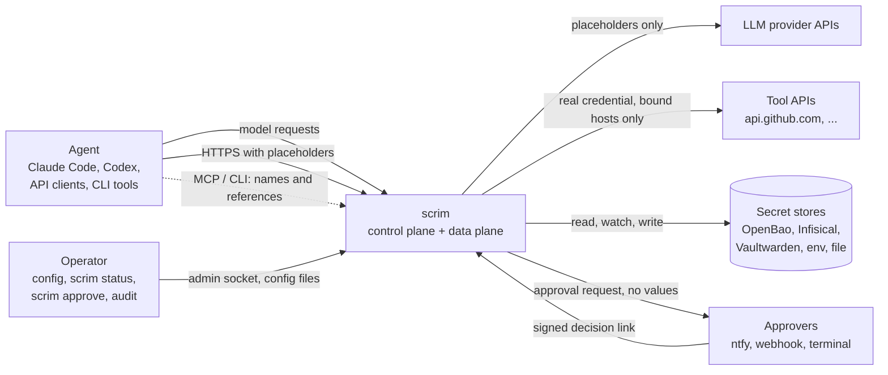
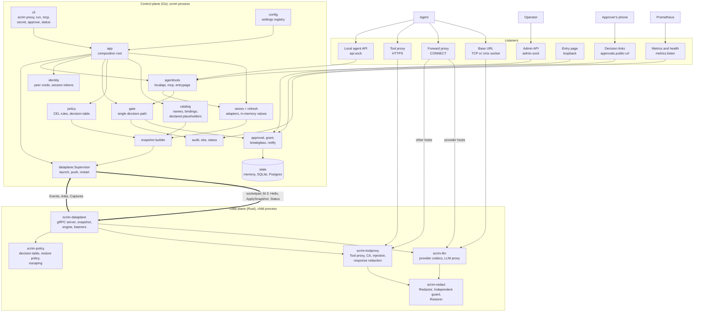
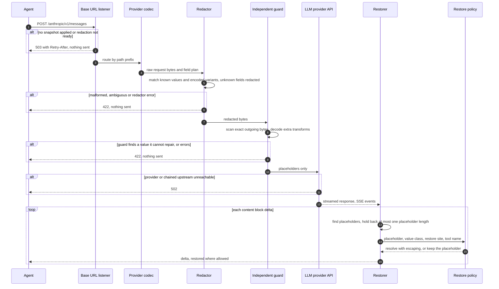
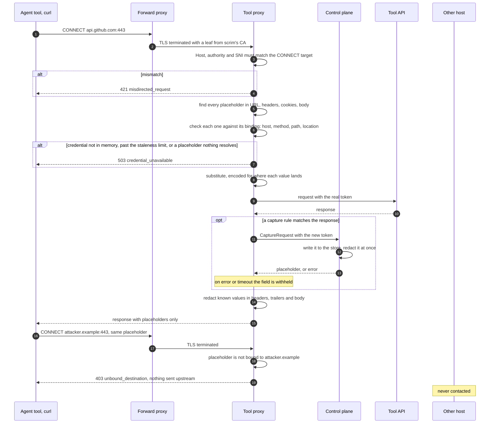
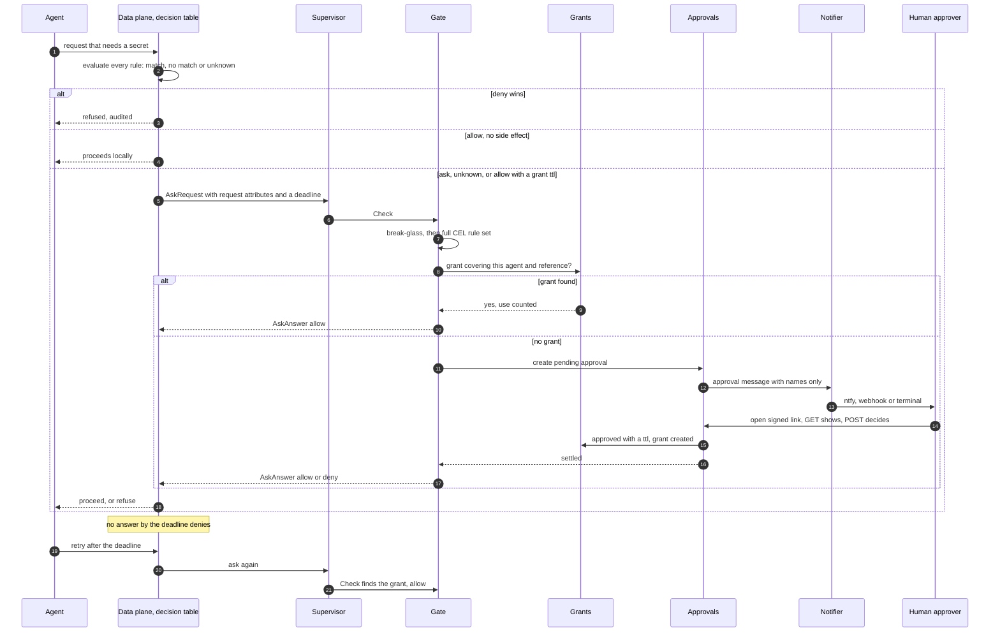
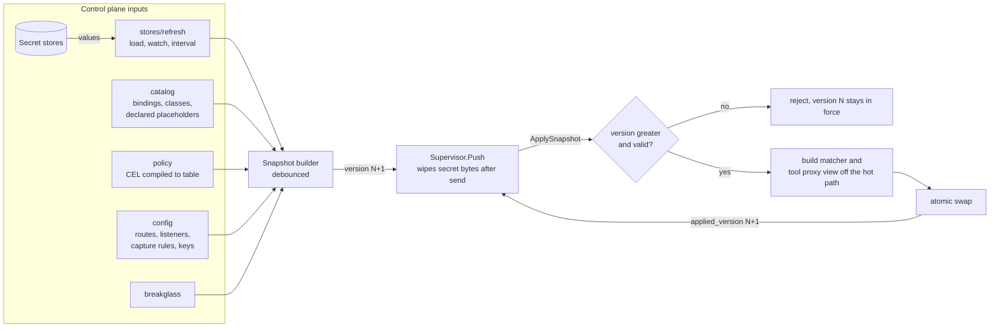
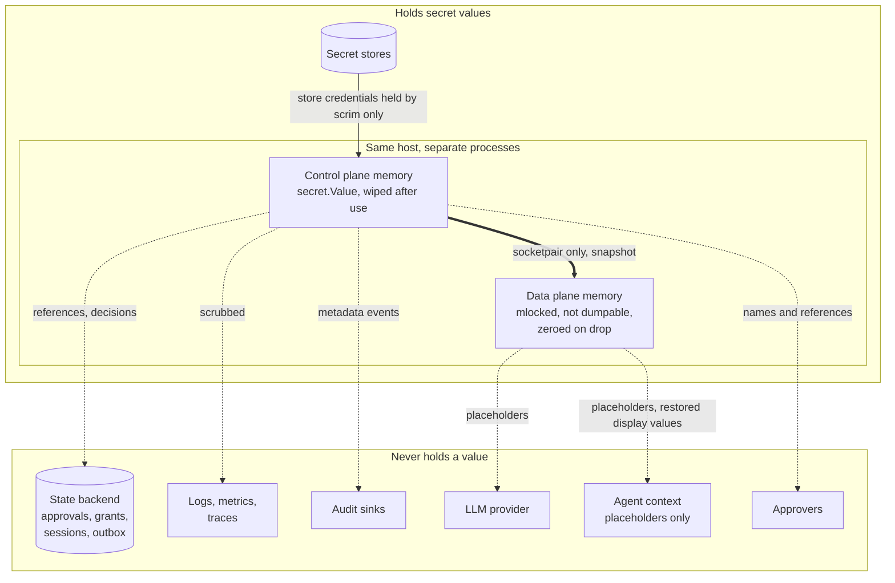
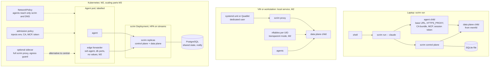

# Architecture

This page shows how scrim is put together and how a request moves through it. It describes the
v0.1.0 design. The normative contract is the OpenSpec change in
[`openspec/changes/scrim-v1`](../openspec/changes/scrim-v1/): the decisions D1 to D13 are in
[`design.md`](../openspec/changes/scrim-v1/design.md), the requirements in its `specs/` directory.
Where this page and the specs disagree, the specs win.

scrim is one binary with two processes at runtime. The Go control plane reads secret stores,
evaluates policy, runs approvals, serves the agent tools and writes the audit log. The Rust data
plane carries every byte of agent traffic: it redacts model requests, restores placeholders in
responses and injects credentials into tool traffic. The control plane pushes everything the data
plane needs as a snapshot, so the data plane decides on its own and calls back only when a rule
asks for a human.

Some parts are not on `main` yet. Each diagram has a status line under it naming them. The
diagrams show the design those branches implement.

## System context

The agent talks to scrim instead of to the provider and the tool APIs directly. The provider only
ever sees placeholders. Tool APIs see the real credential, and only the hosts a credential is bound
to. scrim is the only holder of store credentials (D6), so agents never reach a store themselves:
they create and update secrets through scrim's MCP server or CLI and never read a value back.
Approvers get a message with names and references only, and decide through a signed link. The
operator configures scrim with files, `SCRIM_*` variables and flags (D10) and works through the
admin API.

Status: everything in this picture is on `main` for v0.1.0. `scrim proxy` runs the control plane,
the data plane and every socket, and `scrim run` starts or reuses it for one agent.

## Components

Each half is a set of packages or crates with one job. In the control plane, `app` builds every
long-lived component from the effective configuration and holds no logic. `gate` is the one place
a decision is taken, for agent tool calls and for asks from the data plane alike. The data plane
crates split along the traffic: `scrim-llm` understands provider APIs, `scrim-toolproxy` handles
tool HTTPS, and both call `scrim-redact`, whose redactor and guard share no matching code (D4).

The thick arrows are the boundary (D12): gRPC over a socketpair the control plane creates and the
child inherits as fd 3. Nothing else can connect to it. The control plane pushes snapshots and
reads status; the data plane streams audit events in batches, sends asks and sends captured
values. Every message carries the protocol version, and a mismatch stops the supervisor. The
forward proxy is one listener in front of both engines: provider hosts go to the LLM proxy, every
other host to the tool proxy (D8).

Status: all of this is on `main`. The data plane binds base URL (TCP and Unix socket),
forward-proxy and tool-proxy listeners; provider hosts reached through the forward proxy go to
`scrim-llm`, everything else to the tool proxy. `scrim proxy` runs the snapshot builder, the admin,
agent API, entry page, decision-link and metrics listeners. The data plane decides with
`scrim-policy` (decision table and restore policy from the snapshot, `policy_engine` `table/v1`).

## Request path

The redactor runs over the raw bytes of the request and never decodes and re-serialises the body
(D2), so signed content such as thinking blocks passes byte-identical and prompt caching keeps
working. Placeholders are an HMAC of the value under a versioned key (D3), so the same value always
gives the same bytes. The guard runs after the redactor on the exact bytes about to leave and
decodes transforms the redactor does not try (D4). Any error in either check refuses the request
with a documented status, and there is no fallback that sends the request unredacted.

On the way back the restorer works per content block and holds back enough text to catch a
placeholder split across chunks. The restore policy decides per site and tool: a display value can
be restored with escaping for the shell, SQL, JSON or YAML it lands in, while a credential is never
restored into a command, file edit or tool argument (D5). A placeholder that cannot be resolved
stays a placeholder, which is safe and visible.

Status: on `main`. The LLM proxy, codecs, restorer and fail-closed handling live in `scrim-llm`,
the redactor and guard in `scrim-redact`, and the data plane wires them behind the base URL
listener. Request headers and the request target are redacted and guarded as well as the body. The
data plane restores under
`scrim-policy` ([README](../dataplane/crates/scrim-policy/README.md)): text follows the display mode,
shell and edit tool calls are buffered and restored escaped, credentials are never restored, and
deny or ask rules on `op == "restore"` keep the placeholder. The control plane fills
`Snapshot.restore` from the `restore.*` settings; a snapshot without it restores nothing.

## Tool call with a credential

The agent runs the command the model wrote, placeholder and all. With `HTTPS_PROXY` set, the
command's HTTPS goes through the forward proxy, which terminates TLS with scrim's own CA and hands
the decrypted request to the tool proxy. Bindings are checked against the connection scrim opened,
not against what the request claims, so a shared front end cannot route an injected token to
another tenant (D5). Every placeholder in a request is checked before any is substituted, so one
unbound placeholder refuses the whole request. Every refusal and every injection is an audit event.

Capture rules cover APIs that issue a new secret, such as a token-creation endpoint. The value goes
to the control plane, which writes it to the store and adds it to the redaction set before
answering, and the agent receives the placeholder. A response the proxy cannot scan is withheld,
and so is a captured field whose store write fails.

Status: the tool proxy, CA, bindings, injection, capture and response redaction are on `main` in
`scrim-toolproxy`, and the supervisor's capture stream is on `main`. After the binding checks, every
injection is decided by the decision table (`op == "inject"`), asking the control plane where a rule
says so, and a denial is `403 policy_denied`. The control plane handles captures (stored through
the gate as `store.write`) and holds the CA, which it pushes in the snapshot.

## Ask and approval

The data plane does not run CEL. The control plane lowers each rule into a decision table of plain
string conditions, and anything the table cannot express (time, regular expressions, field to field
comparisons) becomes a residual that returns unknown (D7). The data plane decides alone only when
its answer is certain to match the control plane's; otherwise it asks. This keeps the common case
off the boundary, which matters because synchronous calls across it cost 15 to 30% of throughput
in the D1 benchmark.

The gate re-evaluates the full rule set before it looks at grants, and grants are read from the
state backend on every use, so a revocation or an expiry applies to the next request on every
replica sharing the backend. Decision links are single-use HMAC tokens over approval ID, action,
expiry and notifier. A held request that times out is denied. The approval stays pending, and once
it is approved the grant it leaves behind lets the agent's retry through. Approvals deny on
timeout, and break-glass denies everything except redaction.

Status: the gate, approvals, signed links, notifiers, grants and break-glass are on `main`, as is
the Go reference evaluator for the decision table. The data plane evaluates the table with
`scrim-policy` for every injection and provider request and sends asks over the `Asks` stream,
bounded by `Policy.ask_timeout_millis` (denied on timeout or with the stream down, grants never
cached). An ask carries what the transport said about the caller (`AskCaller`: the session a
request names, Unix peer credentials), since the data plane cannot verify sessions. Connecting the
supervisor's ask stream to the gate, the decision links and the admin API are on `main`. Resolving
`AskCaller` to a verified agent, filling `ask_timeout_millis` from `approvals.timeout`, and `scrim
run` naming its session on every request are in progress on `feat/control-plane-decisions`.

## Snapshot lifecycle

Every input that can change what the data plane does feeds one builder: the values the refresher
holds, catalog bindings and declared placeholders, the policy table, routes, listeners, capture
rules, placeholder keys and the break-glass flag. Each snapshot has a higher version than the last.
The data plane validates it, builds the new matcher without touching live traffic, and swaps it in
with one atomic store, so a request never waits for a rebuild (D2). A rejected snapshot leaves the
previous one in force. A restarted data plane reports version 0 and gets a full push.

Store outages do not weaken redaction. A value stays in the redaction set while its store is
unreachable, and a rotated or deleted value stays for the retention period (24 hours by default).
Injection fails closed: the refresher hands out a value only if the store confirmed it within the
staleness limit (15 minutes by default), and redaction is not ready until the first load completes.
A written or captured value joins the set before the write is reported. If the data plane dies,
the supervisor marks scrim not ready, so health checks fail and nothing is served, then restarts
it with backoff.

Status: on `main`. The daemon builds the full snapshot (values with their bindings, placeholder
keys, decision table, restore settings, routes, listeners, capture rules and CA), pushes it after
every relevant change, debounced, and the data plane applies it as one bundle swapped atomically.

## Trust boundaries

Values live in three places: the stores, the control plane's memory and the data plane's memory.
In the control plane a value is a `secret.Value` from the moment it is read; that type redacts
itself in every formatting and encoding path. The data plane runs as a separate child process that
inherits one end of a socketpair and nothing else (D11). It locks its memory where the limit allows
(`dataplane.memory-lock=require` refuses to start without it), disables core dumps and ptrace
attach, and zeroes values on drop. A crash on either side makes the other refuse traffic.

Nothing in the lower group receives a value. The state backend stores approvals, grants,
sessions and the event outbox, never a value or a placeholder-to-value mapping (D9). Logs pass a
scrubber, metric labels are configured names only, and events from the data plane carry
references and counts. Display values do reach the agent where the restore policy allows them.
The agent's own transcript on disk is outside scrim's protection: the user's machine is trusted,
and a file the agent reads locally is in that transcript before scrim sees any traffic.

Status: all of this is on `main` for the components that exist there.

## Deployments

On a laptop, `scrim run` makes sure a scrim is running for the user, mints a session token bound to
the agent's process tree and starts the agent as its child with every setting applied to that
process only: provider base URLs, the forward proxy, a CA bundle, the MCP registration and the
token. Nothing persistent changes, and if the data plane is not ready the agent is not started.
SQLite is the local state default and refuses a second process on the same file.

A local service (M2) runs `scrim proxy` under a dedicated user from a systemd unit or Quadlet, and
`scrim uninstall` reverts every change. Transparent mode with nftables (M2) or eBPF (M3) catches
agents that were not configured to use scrim. In Kubernetes (M2) a central Deployment serves agent
pods, a NetworkPolicy keeps them from reaching providers directly, an admission policy configures
labelled pods without changing their images, and replicas share PostgreSQL so approvals and grants
agree everywhere. Placeholders need no shared lookup table across replicas because they are an HMAC
of the value (D3). The edge forwarder exposes local sockets such as ssh-agent in the pod and holds
no values. A sidecar (a full `scrim proxy` per pod) holds the dictionary in every pod, so the
central deployment is the default. Valkey and NATS events and extra audit sinks are M3.

Status: v0.1.0 ships the laptop path and the forward proxy; `scrim run` and `scrim proxy` are on
`main`. The Helm chart with central and sidecar modes, the NetworkPolicies and the Kyverno admission
policy are on `main` ([kubernetes.md](kubernetes.md)); the sidecar is a full `scrim proxy`, not
the standalone data plane. The local service, transparent mode, edge forwarder, TokenReview
identity and Postgres notify events are planned for M2;
Valkey, NATS and eBPF for M3. The PostgreSQL state backend and the standalone `scrim-dataplane`
image are on `main`.

## Where to find it in the code

| Component | Code | Design | Docs |
| --- | --- | --- | --- |
| Composition root | `internal/app` | D1 | |
| Command line | `internal/cli` | | [agent-tools.md](agent-tools.md) |
| Settings | `internal/config` | D10 | [configuration.md](configuration.md) |
| Secret value type | `internal/secret` | D9 | |
| Store adapters | `internal/stores/{openbao,infisical,vaultwarden,env,file}` | D6 | [stores/README.md](stores/README.md) |
| Refresh and outages | `internal/stores/refresh` | D6 | [stores/README.md](stores/README.md#freshness-and-outages) |
| Catalog and bindings | `internal/catalog` | D5 | [catalog.md](catalog.md) |
| Policy and decision table | `internal/policy` | D7 | [policy.md](policy.md#how-the-data-plane-decides) |
| Decision path | `internal/gate` | D7 | [policy.md](policy.md) |
| Approvals, grants, break-glass | `internal/approval`, `internal/grant`, `internal/breakglass` | D7 | [approvals.md](approvals.md) |
| Notifiers | `internal/notify/{ntfy,webhook,terminal}` | D7 | [approvals.md](approvals.md#notifiers) |
| Agent identity | `internal/identity` | | [identity.md](identity.md) |
| Agent tools | `internal/agenttools`, `internal/localapi`, `internal/mcp`, `internal/entrypage`, `internal/agentapi` | D6 | [agent-tools.md](agent-tools.md) |
| State backends | `internal/state/{memstate,sqlite,postgres}` | D9 | [state-and-observability.md](state-and-observability.md) |
| Audit | `internal/audit`, `internal/auditlog` | D9 | [state-and-observability.md](state-and-observability.md#audit-log) |
| Logs, metrics, traces, health | `internal/obs` | | [state-and-observability.md](state-and-observability.md#metrics-and-health) |
| `scrim status`, `scrim doctor` | `internal/status` | D10 | [state-and-observability.md](state-and-observability.md) |
| Data plane supervisor | `internal/dataplane` | D11, D12 | [install.md](install.md) |
| Boundary schema | `proto/scrim/dataplane/v1/dataplane.proto` | D12 | |
| Data plane server, snapshot, listeners | `dataplane/crates/scrim-dataplane` | D8, D11, D12 | |
| LLM proxy and provider codecs | `dataplane/crates/scrim-llm` | D2, D4 | |
| Redactor, guard, restorer, placeholders | `dataplane/crates/scrim-redact` | D2, D3, D4, D13 | |
| Tool proxy, CA, injection | `dataplane/crates/scrim-toolproxy` | D5 | |
| Generated boundary code (Rust) | `dataplane/crates/scrim-proto` | D12 | |
| Data plane policy, restore policy, escaping | `dataplane/crates/scrim-policy` | D5, D7 | [README](../dataplane/crates/scrim-policy/README.md) |
| Leak suite | `internal/leak` | D4 | [leak-assurance.md](leak-assurance.md) |
