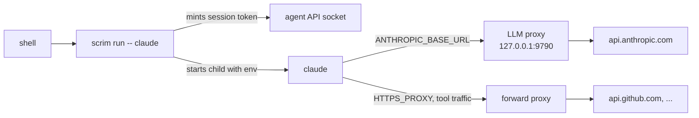
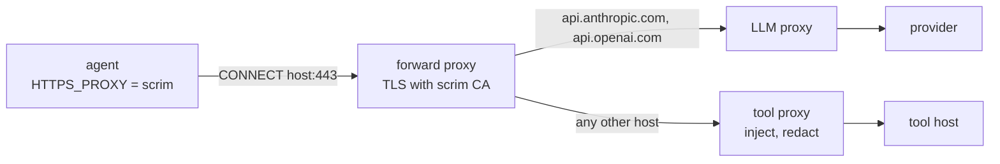
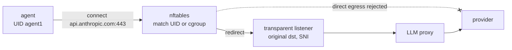
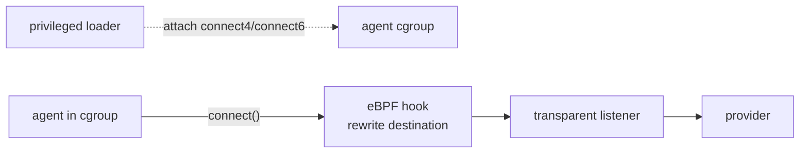
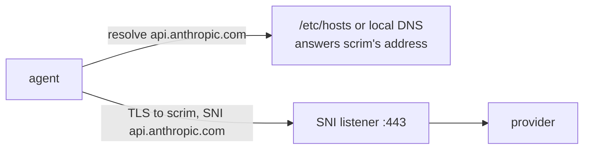
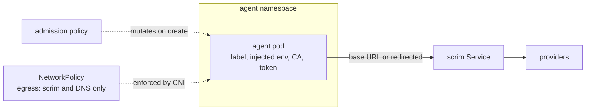
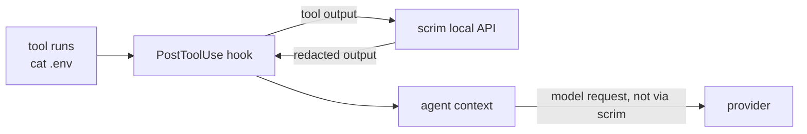
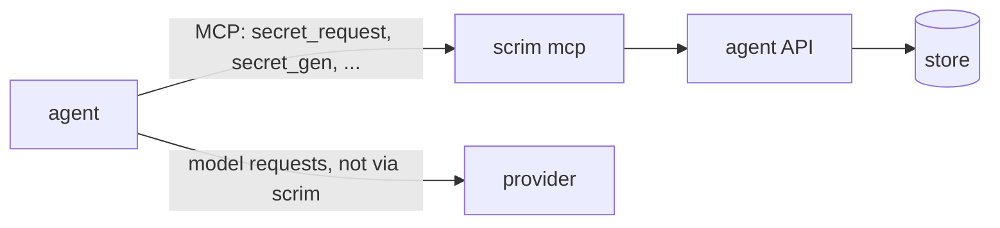
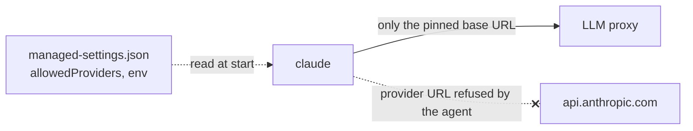

# Interception

scrim can only redact traffic that passes through it. Interception is how an agent's model
requests, and in most methods its tool traffic, end up at scrim instead of going straight to the
provider. There are seven methods. They differ in what has to be configured, who has to cooperate,
and whether an agent that misbehaves can go around scrim. Managed agent settings are not a method
of their own: they are an add-on that keeps methods 1 and 2 from being skipped.

| # | Method | Status | Coverage | Can the agent bypass it? |
| --- | --- | --- | --- | --- |
| 1 | [Wrapper (`scrim run`)](#1-wrapper-scrim-run), with base URL underneath | v0.1.0 | full | yes, by ignoring or clearing its environment |
| 2 | [Forward proxy](#2-forward-proxy) (`HTTPS_PROXY` and CA) | v0.1.0 | full | yes, by ignoring the proxy variables |
| 3 | [Transparent, machine-wide](#3-transparent-machine-wide) (nftables; eBPF variant) | planned, M2 (eBPF M3) | full | no, inside the covered users or cgroups |
| 4 | [DNS override](#4-dns-override) | planned, M3 | full for connections by name | yes, by connecting to an IP address |
| 5 | [Kubernetes transparent](#5-kubernetes-transparent) | planned, M2 | full | no, while NetworkPolicy is enforced |
| 6 | [Hooks only](#6-hooks-only) | planned, M3 | partial: tool output only | yes; model traffic never passes scrim |
| 7 | [MCP only](#7-mcp-only) | v0.1.0 (`scrim mcp` is on `main`) | requests only: nothing is intercepted | not applicable |
| + | [Managed agent settings](#managed-agent-settings-enforcement-add-on) | planned, M2 (manual setup works now) | add-on to 1 and 2 | not through the agent's own settings |

Full coverage means every model request from the covered agent is redacted, and with the forward
proxy its tool traffic gets credential injection and response redaction. Methods 1 and 2 rely on
the agent using the settings it is given: they stop accidents, such as a secret a tool printed or a
file the agent read, from reaching the provider, but they do not stop an agent or a prompt-injected
command that sets out to reach the provider directly. Methods 3 and 5, and managed settings for
the agent's own endpoint, enforce. See [Combining methods](#combining-methods).

Spec: `openspec/changes/scrim-v1/specs/interception`, with design D5, D8 and D11 and the
`deployment` and `agent-identity` specs. The spec names its modes differently; the mapping is in
[Spec modes and these methods](#spec-modes-and-these-methods).

## One engine, several listeners

Every method feeds the same engine (design D8). The data plane has five listener kinds, `BASE_URL`,
`UNIX`, `FORWARD_PROXY`, `TOOL_PROXY` and `TRANSPARENT` (`proto/scrim/dataplane/v1/dataplane.proto`),
and all of them hand provider requests to the same codecs in `scrim-llm`, which redact, guard and
forward. The methods add the plumbing that puts traffic on one of those listeners and, for the
enforcing ones, keep it from going anywhere else.

These settings come up throughout. Each has a config key, a `SCRIM_*` variable and a flag; see
[configuration.md](configuration.md).

| Setting | Default | What it is |
| --- | --- | --- |
| `proxy.listen` | `127.0.0.1:9790` | LLM proxy base URL listener. Agents use `http://127.0.0.1:9790/anthropic` and `http://127.0.0.1:9790/openai/v1` |
| `proxy.socket` | empty (off) | the same LLM proxy on a Unix socket |
| `proxy.forward-listen` | empty (off) | forward proxy (`CONNECT` with TLS interception) |
| `tool-proxy.listen` | empty (off) | the HTTPS tool proxy on its own |
| `api.socket` | `$XDG_RUNTIME_DIR/scrim/api.sock` | local agent API, used by `scrim mcp` and `scrim secret` |
| `proxy.upstream.anthropic` | `https://api.anthropic.com` | where redacted Anthropic requests go |
| `proxy.upstream.openai` | `https://api.openai.com` | where redacted OpenAI requests go |

The data plane on `main` serves every kind except `TRANSPARENT`, and the forward proxy hands
provider hosts to the LLM proxy. A listener that cannot be bound, or whose kind is not implemented,
reports itself unbound, which keeps the data plane not ready, so nothing is forwarded unredacted.
The listener settings above and `scrim proxy`, which turns them into data plane listeners, land
with the daemon (v0.1.0).

The built-in routes are `/anthropic` and `/openai`. The prefix is stripped and the rest of the path
is appended to the upstream, so `/anthropic/v1/messages` goes to
`https://api.anthropic.com/v1/messages`. On the forward-proxy and transparent paths there is no
prefix: the route is picked by host name (`api.anthropic.com`, `api.openai.com`) and the whole path
is forwarded.

## 1. Wrapper (`scrim run`)

`scrim run -- <agent> [args]` starts the agent as its child with every setting it needs applied to
that process tree only: provider base URLs, the forward proxy, a CA bundle, the MCP registration
for `scrim mcp` and a session token. It writes nothing to your shell profile, the agent's
configuration or the system, so running the agent later without the wrapper behaves exactly as
before. The full environment contract per agent is in [run.md](run.md).



### Setup

```sh
scrim run -- claude
scrim run -- codex exec "fix the failing test"
scrim run --print-env -- claude      # show what would be set, start nothing
```

(`scrim run` is on `main`, but it needs the daemon, which lands in v0.1.0. Until then it has no
scrim to start and refuses with status 125.)

`scrim run` finds the scrim already running for your user or starts one, waits until its data
plane is ready to redact, mints a session token bound to its own process tree, creates a session
directory under `$XDG_RUNTIME_DIR/scrim/run/` and starts the agent. When the agent exits the
session is revoked and the directory removed.

What it sets, in short:

| Variable or argument | Value |
| --- | --- |
| `ANTHROPIC_BASE_URL` | `http://127.0.0.1:<port>/anthropic` |
| `OPENAI_BASE_URL` | `http://127.0.0.1:<port>/openai/v1` |
| `HTTPS_PROXY`, `HTTP_PROXY` and lowercase forms | the forward proxy, when `proxy.forward-listen` is set |
| `NO_PROXY`, `no_proxy` | loopback plus chained local upstreams |
| `NODE_EXTRA_CA_CERTS` | the session's `scrim-ca.pem` |
| `SSL_CERT_FILE`, `REQUESTS_CA_BUNDLE`, `CURL_CA_BUNDLE`, `GIT_SSL_CAINFO` and others | the session's `ca-bundle.pem` (system roots plus scrim's CA) |
| `SCRIM_API_SOCKET`, `SCRIM_SESSION_TOKEN`, `SCRIM_SESSION_ID` | for `scrim mcp` and `scrim secret` |
| Claude Code: `--mcp-config=<session>/mcp.json` | registers `scrim mcp` for the session |
| Codex: `-c openai_base_url=...`, `-c mcp_servers.scrim...`, `CODEX_CA_CERTIFICATE` | base URL, MCP server and CA for the session |

With the forward proxy on, `ALL_PROXY` and `all_proxy` are removed. An inherited base URL or proxy
variable is replaced for the session, with a warning.

Where the agent settings come from: Claude Code honours `ANTHROPIC_BASE_URL`, `HTTPS_PROXY`,
`NO_PROXY` and `NODE_EXTRA_CA_CERTS` (Claude Code docs, "Enterprise network configuration" and
"Environment variables", checked against v2.1.329). Current Codex reads the OpenAI base URL from the
`openai_base_url` config key rather than the environment (Codex docs, "Advanced configuration"), so
`scrim run` passes it with `-c`, which leaves `~/.codex/config.toml` alone. Codex reads custom CA
material from `CODEX_CA_CERTIFICATE`, falling back to `SSL_CERT_FILE` (`codex-rs/http-client` in the
Codex source; `scrim run` is tested against Codex CLI 0.171).

### Base URL (manual)

The base URL listener is what the wrapper points agents at, and you can point an agent at it
yourself. scrim redacts the request, forwards it to the real provider and restores placeholders in
the response. The agent keeps its own API key or login; scrim passes the agent's authentication
through.

Start the daemon (lands with the daemon, v0.1.0):

```sh
scrim proxy
```

Claude Code, for one run or persistently in `~/.claude/settings.json`:

```sh
ANTHROPIC_BASE_URL=http://127.0.0.1:9790/anthropic claude
```

```json
{
  "env": {
    "ANTHROPIC_BASE_URL": "http://127.0.0.1:9790/anthropic"
  }
}
```

Codex, for one run or in `~/.codex/config.toml` (Codex ignores `openai_base_url` in a project's
`.codex/config.toml`, per its docs):

```sh
codex -c openai_base_url="http://127.0.0.1:9790/openai/v1"
```

```toml
openai_base_url = "http://127.0.0.1:9790/openai/v1"
```

SDK-based agents read `ANTHROPIC_BASE_URL` and `OPENAI_BASE_URL`.

The same LLM proxy can listen on a Unix socket:

```sh
scrim proxy --proxy-socket "$XDG_RUNTIME_DIR/scrim/llm.sock"
curl --unix-socket "$XDG_RUNTIME_DIR/scrim/llm.sock" http://scrim/anthropic/v1/messages ...
```

The socket is created with mode 0600 and removed when the listener stops. Neither Claude Code nor
Codex documents a way to use a Unix socket as its base URL, so this listener is for your own
clients, SDKs with a custom transport and edge forwarders. File permissions decide who can connect,
which a loopback port cannot do, and peer credentials can identify the caller (agent-identity spec,
"Unix socket peer credentials").

A manual base URL covers model traffic only. Tool traffic needs the forward proxy as well.

### What it protects against

Everything the agent sends to the provider through the SDKs it uses: file contents it read, command
output, a secret pasted into the prompt. With the forward proxy on, the agent's tool traffic (curl,
git, SDKs that honour the proxy variables) goes through the tool proxy, which injects credentials
toward their bound hosts and redacts responses.

### What it does not

- An agent, or a command the model wrote, that ignores the variables. `env -i curl
  https://api.anthropic.com/...`, a subprocess started with a clean environment, or a client that
  hard-codes its endpoint goes straight out.
- Anything that changes the agent's settings: an exported variable, a project or user settings
  file, a flag, or a model that edits the agent's own config. [Managed agent
  settings](#managed-agent-settings-enforcement-add-on) close this for the agent itself.
- A client that pins certificates or ships its own trust store; see [CA trust per
  runtime](#ca-trust-per-runtime).
- Claude Code on Bedrock, Vertex or Foundry, and Codex with a custom `model_provider`: those go to
  endpoints scrim does not serve. `scrim run` refuses the Claude Code cases and cannot change the
  Codex one; see [run.md](run.md#limitations). Codex signed in with a ChatGPT account reaches
  `chatgpt.com` and `ab.chatgpt.com`, which the forward proxy hands to the LLM proxy.

### TLS and CA

The LLM base URL is plain HTTP on loopback and needs no CA. Keep it on loopback (`proxy.listen`
says so). The forward proxy needs the session CA bundle, which `scrim run` builds for the child
only. Nothing is installed in a trust store.

### Suits

One person running Claude Code, Codex or any SDK-based agent on a laptop or workstation, CI jobs
that start the agent themselves, and trying scrim out.

### Fails closed

`scrim run` does not start the agent (status 125) when scrim cannot start, its data plane is not
ready, a listener is not bound, the session cannot be minted or the preset refuses the environment.
If scrim stops mid-session, the agent's requests to the loopback base URL and the proxy fail with a
connection error; they do not fall back to the provider. Before its first snapshot the data plane
refuses with 503 `not_ready`. The weakening setting `run.allow-unredacted-start` starts the agent
anyway with your environment unchanged, and `scrim status` lists it.

## 2. Forward proxy

scrim acts as an HTTP forward proxy. Agents that honour `HTTPS_PROXY` open a `CONNECT` tunnel to
scrim for every HTTPS host. scrim terminates TLS with a leaf certificate signed by its own CA,
then sends provider hosts to the LLM proxy and every other host to the tool proxy, which injects
bound credentials and redacts responses. No base URL changes; one listener carries both kinds of
traffic. This is the method for "I don't want to change the proxy URL".



### Setup

Pick a free loopback port for the forward proxy; it has no default. Trust scrim's CA for your user
and start the daemon (`scrim proxy` and `scrim ca` land with the daemon, v0.1.0):

```sh
scrim ca install --user --dry-run   # show what would change
scrim ca install --user
scrim proxy --proxy-forward-listen 127.0.0.1:9791
```

`scrim ca install --user` writes `~/.local/share/scrim/scrim-ca.pem` and a combined
`ca-bundle.pem` (system roots plus scrim's CA), adds the CA to the macOS login keychain or to
`~/.pki/nssdb` where they exist, and records each change so `scrim ca uninstall --user` can revert
it. See [ca.md](ca.md).

Claude Code:

```sh
export HTTPS_PROXY=http://127.0.0.1:9791
export NO_PROXY=localhost,127.0.0.1,::1
export NODE_EXTRA_CA_CERTS=~/.local/share/scrim/scrim-ca.pem
claude
```

Claude Code reads `https_proxy`, `HTTPS_PROXY`, `http_proxy`, `HTTP_PROXY` in that order and does
not support SOCKS proxies (Claude Code docs, "Enterprise network configuration").

Codex:

```sh
export HTTPS_PROXY=http://127.0.0.1:9791
export NO_PROXY=localhost,127.0.0.1,::1
export CODEX_CA_CERTIFICATE=~/.local/share/scrim/ca-bundle.pem
codex
```

Codex first tries the Responses API over WebSocket. scrim serves HTTP only, so Codex falls back to
HTTPS after a few seconds; both attempts go through scrim (observed in `scrim run`'s Codex tests).

Other runtimes are in [CA trust per runtime](#ca-trust-per-runtime).

### What it protects against

Model traffic as with the base URL, plus every HTTPS request from tools that honour the proxy
variables. A placeholder sent toward a host its credential is not bound to is refused. The tool
proxy never passes a connection through uninspected: a client that refuses scrim's certificate, or
does not speak TLS inside the tunnel, has its connection closed, and the destination is recorded in
the data plane status as unsupported.

### What it does not

- A process that ignores the proxy variables, clears its environment, or connects by address with
  its own socket code.
- A client that pins the provider's certificate: it fails closed rather than leaking, but it does
  not work through scrim.
- Protocols other than HTTP over TLS. SSH, database ports and plain TCP are not proxied (the
  ssh-agent and database proxies are separate work, tasks.md 15.4 and 15.5).

### TLS and CA

Required. Every client in the agent's process tree must trust scrim's CA; see [CA trust per
runtime](#ca-trust-per-runtime). The CA key lives in `$XDG_STATE_HOME/scrim/ca`. On a single-user
machine the agent's user can read it, so run scrim as its own user if that matters
([ca.md](ca.md)).

### Suits

Agents whose base URL you cannot or do not want to change, and any setup where tool traffic should
get credential injection. Usually combined with the wrapper, which sets the variables for you.

### Fails closed

With scrim down, `CONNECT` to the proxy address fails and nothing goes direct.

## 3. Transparent, machine-wide

Planned for M2 (tasks.md 13.3). On Linux, `scrim install` adds nftables rules that match outgoing
connections from selected users or control groups to provider hosts and redirect them to a
`TRANSPARENT` listener. That listener recovers the original destination, reads the TLS server name
(SNI), terminates TLS with scrim's CA and hands the request to the route for that host. The same
rules reject any direct connection from those users or cgroups to the provider. The agent needs no
configuration at all.



### Setup

There are no commands yet: the `TRANSPARENT` listener kind exists in the boundary schema and the
data plane on `main` reports it unbound. The deployment spec requires `scrim install` to show every
rule before adding it and `scrim uninstall` to remove each one.

Covering by UID means running each agent under its own Unix user. scrim's own user has to be left
out of the rules, or its upstream connections would be redirected back to itself. Covering by cgroup
lets agents run as your user, as long as they start inside the cgroup, for example a systemd scope.

### What it protects against

An agent that ignores every setting, subprocesses with a clean environment, and clients that
hard-code the provider's address. Inside the covered UID or cgroup there is no path to the provider
that skips scrim.

### What it does not

A process outside the covered users or cgroups. A process that moves itself out of a covered cgroup
(that needs write access to another cgroup's `cgroup.procs`). Hosts that are not in the rule set,
such as a provider endpoint scrim has no route for, are not redirected; whether they are blocked
depends on the rules you choose. A pinning client fails.

### TLS and CA

Required, as for the forward proxy: the agent connects to what it thinks is the provider and sees
scrim's certificate. The interception spec requires the CA to be installed for the system store and
for Node.js, Python, OpenSSL-based tools and Java when this method is installed.

### Suits

A VM or workstation running agents as a service, several agents on one machine, CI runners where
you control the host, and any agent you cannot configure.

### Fails closed

The redirect and the deny are kernel rules and stay in place when scrim stops. The agent's
connections are redirected to a port nobody listens on and fail; they never go direct.

### Variant: eBPF cgroup hooks

Planned for M3 (tasks.md 15.1). Instead of packet filter rules, a privileged loader attaches eBPF
programs to the `cgroup/connect4` and `cgroup/connect6` hooks of selected control groups. When a
process in the cgroup calls `connect()` to a provider address, the program rewrites the destination
to scrim's transparent listener; a direct connection to the provider is denied. This gives
per-cgroup redirect and deny without separate Unix users or nftables rule sets.



It is Linux only and needs cgroup v2. The loader needs `CAP_BPF` and `CAP_NET_ADMIN`, or root;
agents run unprivileged. If the loader is not installed or lacks the rights, scrim does not report
the method as active and `scrim status` names the missing privilege (spec, "Loader not available").
eBPF only moves the traffic (design D8): TLS interception still happens in scrim's listener, so the
CA is still required and a pinning client still fails. The programs stay attached when scrim stops,
so redirected connections fail. It suits hosts that already manage agents per cgroup, such as
systemd units, container runtimes or one `scrim run` scope per agent.

## 4. DNS override

Planned for M3 (tasks.md 15.2). Provider host names resolve to scrim, through `/etc/hosts` or a
local resolver. The agent connects to scrim on port 443 believing it is the provider, scrim reads
the server name from the TLS handshake (SNI), serves a certificate for that name from its CA, picks
the route by host and forwards the redacted request. Design D8 calls this the SNI listener on 443.



### Setup

No commands yet. scrim itself must resolve the real provider addresses, so the override cannot
apply to scrim's own resolver.

### What it protects against and what it does not

Agents that use the system resolver and connect by name, with no change to the agent. It does not
stop a connection made by IP address, a hard-coded IP, a client with its own DNS (DNS over HTTPS, a
hard-coded resolver), or a cached answer from before the override. `scrim status` will report that
this method does not stop connections made by address (spec, "DNS override mode"). Combine it with
transparent mode if that matters.

### TLS and CA

Required: the agent validates scrim's certificate for the provider's name.

### Suits

Appliances and tools that cannot take a proxy or a base URL, and as a first step where an enforcing
method follows.

### Fails closed

The name still resolves to scrim when scrim is stopped, so connections by name fail. Connections by
address were never covered.

## 5. Kubernetes transparent

Planned for M2 (tasks.md 12.3). The Helm chart installs an admission policy (Kyverno in the plan)
that configures pods carrying the scrim agent label when they are created: the base URL variables,
the CA bundle mounted into the pod, the MCP configuration and a projected service account token with
a scrim-specific audience, which scrim uses to identify the pod as `namespace/serviceaccount`. A
NetworkPolicy lets those pods reach only scrim and DNS, and lets scrim reach providers, stores and
notifiers. Agent images do not change.

For agents that ignore the injected variables, traffic can be redirected to scrim without them: an
init container that installs redirect rules in the pod's network namespace (it needs `NET_ADMIN`),
a CNI plugin that does the same, or an egress gateway that all provider traffic leaves through. The
specs require injection and NetworkPolicy only; which redirect scrim ships is not decided.



### Setup

The chart, its values and the label name are not published yet. The NetworkPolicy part is plain
Kubernetes; a policy of this shape, with your own labels, is what the chart will create:

```yaml
apiVersion: networking.k8s.io/v1
kind: NetworkPolicy
metadata:
  name: agents-egress-scrim-only
  namespace: agents
spec:
  podSelector:
    matchLabels:
      <your-agent-label>: "true"
  policyTypes: [Egress]
  egress:
    - to:
        - namespaceSelector:
            matchLabels:
              kubernetes.io/metadata.name: scrim
      ports:
        - protocol: TCP
          port: 9790
    - to:
        - namespaceSelector: {}
          podSelector:
            matchLabels:
              k8s-app: kube-dns
      ports:
        - protocol: UDP
          port: 53
        - protocol: TCP
          port: 53
```

A NetworkPolicy only works when the cluster's CNI enforces it.

### What it protects against

Everything inside the pod: an agent that ignores its environment, subprocesses, hard-coded
addresses. Pod identity comes from the projected token, so one pod cannot act as another.

### What it does not

Pods without the label, a CNI that ignores NetworkPolicy, and anyone who can edit the policy or the
pod spec. Tool traffic to hosts outside the cluster is blocked outright unless the pod uses scrim's
forward proxy or the policy allows those hosts.

### TLS and CA

The mounted CA bundle is needed for tool traffic through scrim's forward proxy and for any
redirected TLS connection. The specs do not yet say whether pods reach the scrim Service over plain
HTTP or TLS.

### Suits

Agent workloads in Kubernetes, CI on Kubernetes runners. A central scrim Deployment serves many
pods; a `scrim-dataplane` sidecar per pod is possible but puts the value dictionary in every pod, so
the design prefers the central one.

### Fails closed

NetworkPolicy keeps the deny when scrim is down or scaled to zero: the pod can reach the scrim
Service and DNS only, and with no ready scrim endpoint its requests fail.

## 6. Hooks only

Planned for M3 (tasks.md 15.3). Hooks are scripts the agent runs at points in its loop. scrim's hook
adapter will run after each tool call, send the tool output to scrim's local API and give the agent
a redacted copy, so a secret a tool printed never enters the conversation. No network setup is
needed, and it is the weakest method.



### What the agents offer

Claude Code's `PostToolUse` hook can return `updatedToolOutput`, which replaces the tool's output
before Claude sees it; for built-in tools the value must match the tool's output shape (Claude Code
docs, "Hooks reference"). The tool has already run by then, so side effects are not undone.

Codex's `PostToolUse` hook cannot rewrite output: `updatedMCPToolOutput` is parsed but not
supported. A hook can return `decision: "block"` or `continue: false`, which replaces the result
with the hook's feedback text (Codex docs, "Hooks"). That is enough to withhold a result that
contains a secret, not to pass on a redacted one.

### What it does not protect

`scrim status` reports a hooks-only setup as partial. Not covered:

- the model request itself: the prompt, files attached to it, anything that did not come back as a
  tool result;
- placeholders: nothing restores them on the way back, so the agent sees placeholders it cannot
  use;
- tool traffic and credential injection;
- direct traffic of any kind, and tools the hook does not match.

### Suits

Agents that cannot be pointed at scrim at all, as a stopgap.

### Fails closed

Only if the hook treats an unreachable scrim as an error and blocks the result. The model traffic is
not behind scrim in this method, so there is nothing else to fail closed.

## 7. MCP only

No traffic interception at all. The agent gets scrim's tools through `scrim mcp` (or the
`scrim secret` commands) and uses them to find, request, generate, capture and ask a person for
secrets. Values move around the model instead of through it: `secret_gen` makes a value inside
scrim and writes it to the store, `secret_capture` runs a command and sends only the extracted
value to scrim, `secret_ask_human` has a person type the value into a local entry page, and
`secret_request` asks for a just-in-time grant that an approver can allow or deny. No tool takes or
returns a value. See [agent-tools.md](agent-tools.md).



### Setup

The MCP server and the agent API are on `main`:

```sh
scrim api serve
claude mcp add scrim -- scrim mcp
```

For Codex, in `~/.codex/config.toml`:

```toml
[mcp_servers.scrim]
command = "scrim"
args = ["mcp"]
```

### What it protects against and what it does not

It protects the flows that go through the tools: a secret created, captured or requested through
scrim never appears in the conversation. It does nothing about accidental reads. If the agent runs
`cat .env` or opens a config file, the value goes to the provider in the next request. Pair it with
rules that keep the agent away from secret files. For Claude Code, deny the Read tool with a
permission rule and deny sandboxed commands with `sandbox.filesystem.denyRead`, which applies at the
OS sandbox boundary to every subprocess a sandboxed command starts (Claude Code settings reference):

```json
{
  "permissions": {
    "deny": ["Read(./.env)", "Read(./.env.*)"]
  },
  "sandbox": {
    "enabled": true,
    "filesystem": {
      "denyRead": ["./.env", "~/.aws/credentials"]
    }
  }
}
```

Without traffic through scrim, placeholders the tools hand out are not resolved toward providers or
tool hosts, and nothing redacts responses.

### Suits

Teams that want agents to create and request secrets safely before routing traffic through scrim,
and as a companion to every other method: methods 1 to 5 handle the traffic, the MCP tools handle
the deliberate secret work.

### Fails closed

There is no traffic to fail closed. A tool call to an unreachable scrim returns `unavailable`.

## Managed agent settings (enforcement add-on)

Some agents let an administrator install a policy that the user and the project cannot override.
scrim uses that to pin the agent to its endpoint, so the wrapper or a manual base URL cannot be
skipped by changing the agent's settings. Claude Code has the pieces for this today; scrim
installing them for you is planned for M2 (tasks.md 13.4).



### Claude Code

Write `/etc/claude-code/managed-settings.json` on Linux and WSL, or
`/Library/Application Support/ClaudeCode/managed-settings.json` on macOS (Windows:
`C:\Program Files\ClaudeCode\`):

```json
{
  "allowedProviders": ["customEndpoint"],
  "env": {
    "ANTHROPIC_BASE_URL": "http://127.0.0.1:9790/anthropic"
  }
}
```

`allowedProviders` lists the services a machine may reach Claude through. `customEndpoint` is
admitted only for the exact value a managed `env` block pins, and a session on any other provider is
refused at startup, at login and on its next API call. A value in `env` overwrites the same variable
exported in your shell. Both keys and both behaviours are from the Claude Code settings reference
(`allowedProviders` needs v2.1.285 or later). Run `/status` in Claude Code to see which managed
source applied. To send tool traffic through the forward proxy as well, add `HTTPS_PROXY`,
`NO_PROXY` and `NODE_EXTRA_CA_CERTS` to the same `env` block.

### Codex

Codex reads admin-enforced requirements from `/etc/codex/requirements.toml` on Linux and macOS. Its
`model_provider` key enforces the provider ID over local and session configuration, and
`model_providers.<id>` defines that provider completely (Codex configuration reference,
"requirements.toml"):

```toml
model_provider = "scrim"

[model_providers.scrim]
name = "OpenAI through scrim"
base_url = "http://127.0.0.1:9790/openai/v1"
env_key = "OPENAI_API_KEY"
```

This is an untested sketch: scrim's tests have not run Codex under it yet.

### What it adds and what it does not

The user, a project file or the model can no longer change the agent's endpoint through the
agent's own settings; a prompt-injected "set `ANTHROPIC_BASE_URL` to the provider" does nothing. It
does not cover commands the agent runs: `curl https://api.anthropic.com/...` from the Bash tool is a
separate process the policy does not touch. Anyone with root or write access to the managed file can
change it (on WSL `/etc/claude-code` is user-writable, per Claude Code's docs). For processes, use
method 3 or 5.

With scrim down, the agent's only allowed endpoint does not answer and it gets a connection error.
An empty or unreadable `allowedProviders` list makes Claude Code refuse every provider and not
start.

## CA trust per runtime

Every method that terminates TLS (2 to 5, and the wrapper when the forward proxy is on) needs the
client to trust scrim's CA. `scrim ca export` prints the certificate; `scrim ca install --user`
writes `~/.local/share/scrim/scrim-ca.pem` and `ca-bundle.pem` (lands with the daemon, v0.1.0).
`scrim run` builds the same two files per session.

| Runtime | How it trusts scrim's CA |
| --- | --- |
| System store | Debian and Ubuntu: copy the PEM to `/usr/local/share/ca-certificates/scrim-ca.crt` and run `update-ca-certificates`. Fedora and RHEL: copy it to `/etc/pki/ca-trust/source/anchors/` and run `update-ca-trust`. macOS: `security add-trusted-cert -d -r trustRoot -k /Library/Keychains/System.keychain scrim-ca.pem`. `scrim ca install --system` is not implemented yet |
| Node.js, Claude Code | `NODE_EXTRA_CA_CERTS=~/.local/share/scrim/scrim-ca.pem` adds to the bundled roots. Or trust the system store with `NODE_USE_SYSTEM_CA=1` (Node 24.6 and 22.19 or later) or `--use-system-ca` (Node 23.8 or later). Claude Code already reads the system store by default (`CLAUDE_CODE_CERT_STORE=bundled,system`) |
| OpenSSL, Go, Ruby, curl, git | `SSL_CERT_FILE`, `CURL_CA_BUNDLE`, `GIT_SSL_CAINFO` pointing at `ca-bundle.pem`. These replace the roots, which is why the bundle includes the system roots |
| Python | `REQUESTS_CA_BUNDLE` for requests, `SSL_CERT_FILE` for the `ssl` module |
| Codex | `CODEX_CA_CERTIFICATE`, falling back to `SSL_CERT_FILE` |
| Java | import into a truststore: `keytool -importcert -cacerts -alias scrim -file scrim-ca.pem`, or a separate store passed with `-Djavax.net.ssl.trustStore=...` (for example in `JAVA_TOOL_OPTIONS`). Not covered by `scrim ca install` or `scrim run` yet |

A client that pins the provider's certificate or public key will not accept scrim's leaf, whatever
it trusts. That is a failure, not a leak: the handshake fails, the tool proxy closes the connection
and records the destination as unsupported, and no request is sent. Such a client can only be used
through a base URL, if it has one.

After a CA rotation the previous CA stays valid for `tool-proxy.ca.overlap` (7 days), with a cross
certificate on each leaf, so clients that trust the old CA keep working while you update them. Bundle
files written by `scrim ca install --user` are refreshed on rotation; the keychain and NSS entries
are not ([ca.md](ca.md)).

## Choosing a method

| Situation | Start with | Add for enforcement |
| --- | --- | --- |
| Laptop, one agent, you start it | 1, wrapper (`scrim run -- claude`) | managed settings |
| Several agents on one machine | 1, wrapper per agent, each with its own session | 3, transparent per UID or cgroup |
| CI job | 1, wrapper around the agent step, or a base URL in the job | 3 on self-managed runners, 5 on Kubernetes runners |
| VM or workstation service | `scrim proxy` as a service with 2, forward proxy, or a base URL | 3, transparent |
| Kubernetes | 5, injection by label | NetworkPolicy, part of 5 |
| "I don't want to change the proxy URL" | 2, forward proxy | 3, or 4 where nothing else fits |
| Agent you cannot configure | 3, transparent | already enforcing; 4 alone misses connections by address |
| Agent you cannot route at all | 6, hooks, knowing they are partial | none available |
| Only deliberate secret work for now | 7, MCP, with read-deny rules | move to 1 or 2 |

Only methods 1, 2 and 7 exist in v0.1.0. Until M2, the closest thing to enforcement on one machine
is Claude Code's managed settings written by hand.

## Combining methods

Methods stack. The common combinations:

- Wrapper with forward proxy: This is what `scrim run` does when `proxy.forward-listen` is set:
  model traffic on the base URL, tool traffic through the forward proxy, CA bundle for the child.
- Base URL with transparent mode as enforcement: The agent is configured with the base URL, so
  its normal traffic needs no TLS interception. The nftables or eBPF rules catch anything that goes
  around it and deny the direct connection.
- Wrapper or base URL with managed settings: The policy pins the endpoint so it cannot be
  changed through the agent; the base URL listener does the work.
- Kubernetes injection with NetworkPolicy: Injection sets the base URL and CA; the policy is the
  enforcement. One without the other is configuration with no enforcement, or enforcement that
  breaks unconfigured pods.
- DNS override under transparent mode: DNS makes name-based clients work without a proxy
  setting; the packet rules deny connections by address.
- Any of 1 to 5 with MCP: The traffic method redacts; the tools cover creating and requesting
  secrets. `scrim run` registers `scrim mcp` by default.

Chained upstreams stay behind scrim: a context-compression proxy such as caveman is configured as
`proxy.chain.url` and receives redacted requests only. Its loopback address is excluded from the
forward proxy and from redirection so traffic does not loop (spec, "Local chained proxies are not
intercepted").

## How each method fails closed

| Method | scrim stopped or failing | Can the agent fall back to the provider? |
| --- | --- | --- |
| 1. Wrapper | agent not started (status 125); a running agent gets connection errors | only by ignoring its environment |
| 2. Forward proxy | `CONNECT` fails; uninspectable tunnels are closed | only by ignoring the proxy variables |
| 3. Transparent (nftables or eBPF) | redirect and deny stay in place; connections fail | no |
| 4. DNS override | names resolve to a dead address | yes, by address |
| 5. Kubernetes | NetworkPolicy stays; only scrim and DNS reachable | no |
| 6. Hooks only | depends on the hook | yes; model traffic never went through scrim |
| 7. MCP only | tool calls return `unavailable` | nothing was intercepted |
| Managed settings | the one allowed endpoint does not answer | not through the agent; yes through other processes |

In every method that carries traffic, a redaction or guard failure refuses the request. Nothing is
ever forwarded unredacted as a fallback.

## Verifying

### Capture mode

Capture mode writes every provider request exactly as it left scrim, and the response as received,
to a directory (mode 0700). Agent credentials in headers are masked.

```sh
scrim proxy --capture ~/scrim-capture
```

(Lands with the daemon, v0.1.0. The flag takes a directory; `proxy.capture.dir` is the setting and
`proxy.capture.retention` deletes old files, 7 days by default.) Run a session that reads a file
holding a secret, then search the capture directory for the value. It should be absent, with its
placeholder in its place.

### `scrim status` and `scrim doctor`

`scrim status` has an Interception section listing the active methods, alongside protections,
stores, the data plane and every weakened setting such as `run.allow-unredacted-start`.
`scrim doctor` turns the same report into checks, prints each problem with a fix and exits non-zero
when one fails. The spec asks both to show, per agent or scope, the active method, whether direct
egress is blocked, CA trust, chained upstreams and every known gap; a wrapper with no enforcement
should read as redaction active, direct egress not blocked. On `main` no component reports
interception yet, so the section prints `none active`.

Inside a wrapped session, `scrim api whoami` shows that the agent is identified by its session.

### `scrim audit run`

The leak suite sends a bypass matrix and realistic agent sessions through the proxy you name and
checks what reached a fake provider. Point scrim's upstreams at the fake provider and run the suite
against the base URL listener:

```sh
SCRIM_PROXY_UPSTREAM_ANTHROPIC=http://127.0.0.1:18089 \
SCRIM_PROXY_UPSTREAM_OPENAI=http://127.0.0.1:18089 \
  scrim proxy &
scrim audit run --proxy http://127.0.0.1:9790 --upstream-listen 127.0.0.1:18089 \
  --route anthropic=/anthropic --route openai-chat=/openai --route openai-responses=/openai \
  --seeds-out ./leak-seeds.json --report leak-report.json
```

The seeds have to be in a store scrim reads before the traffic runs;
[leak-assurance.md](leak-assurance.md) has the full procedure and what each outcome means. The suite
tests the base URL path. To check an enforcing method, also try the bypass yourself from inside the
covered scope, for example `curl https://api.anthropic.com/v1/messages` as the agent's user or from
its cgroup or pod, and confirm it fails.

## Spec modes and these methods

| Spec requirement (interception spec) | Method on this page |
| --- | --- |
| Wrapper mode | 1 |
| Base URL mode | 1, "Base URL (manual)" |
| Forward proxy mode | 2 |
| Transparent mode with packet filtering | 3 |
| Transparent mode with eBPF | 3, eBPF variant |
| DNS override mode | 4 |
| Kubernetes injection | 5 |
| Hooks-only mode is reported as partial | 6 |
| Managed agent settings | managed settings add-on |
| (none; agent-tools spec) | 7 |
| CA trust installation | CA trust per runtime |
| Enforcement fails closed | How each method fails closed |
| Doctor and status report protections | Verifying |
