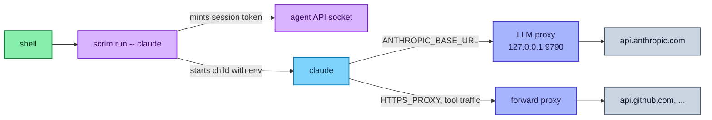
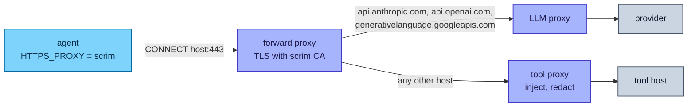
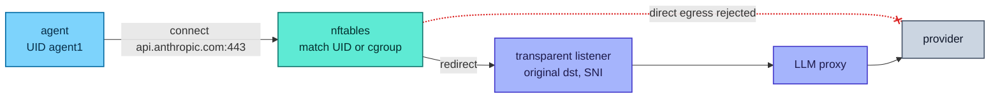
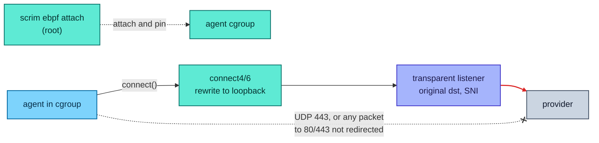
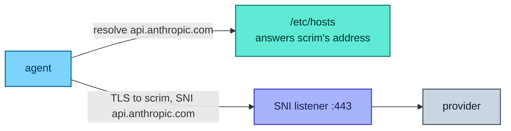
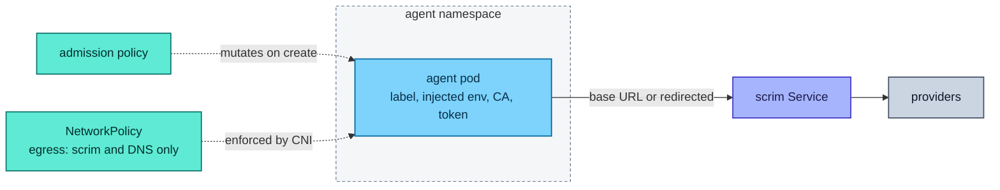
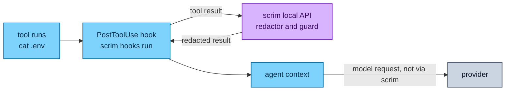
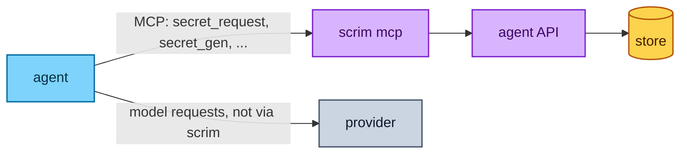
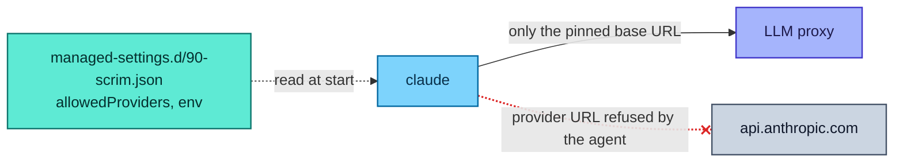

# Interception

scrim can only redact traffic that passes through it. Interception is how an agent's model
requests, and in most methods its tool traffic, end up at scrim instead of going straight to the
provider. There are seven methods. They differ in what has to be configured, who has to cooperate,
and whether an agent that misbehaves can go around scrim. Managed agent settings are not a method
of their own: they are an add-on that keeps methods 1 and 2 from being skipped.

| # | Method | Set up with | Coverage | Can the agent bypass it? |
| --- | --- | --- | --- | --- |
| 1 | [Wrapper (`scrim run`)](#1-wrapper-scrim-run), with base URL underneath | `scrim run` | full | yes, by ignoring or clearing its environment |
| 2 | [Forward proxy](#2-forward-proxy) (`HTTPS_PROXY` and CA) | `proxy.forward-listen` | full | yes, by ignoring the proxy variables |
| 3 | [Transparent, machine-wide](#3-transparent-machine-wide) (nftables; eBPF variant) | `scrim install --transparent`; eBPF variant: `scrim install --ebpf` or `scrim ebpf attach` | full | no, inside the covered users or cgroups |
| 4 | [DNS override](#4-dns-override) | `scrim install --dns` | full for connections by name | yes, by connecting to an IP address |
| 5 | [Kubernetes transparent](#5-kubernetes-transparent) | Helm chart, Kyverno injection, NetworkPolicy | full | no, while NetworkPolicy is enforced |
| 6 | [Hooks only](#6-hooks-only) | `scrim install --hooks` | partial: tool results and prompts only | yes; model traffic never passes scrim |
| 7 | [MCP only](#7-mcp-only) | `scrim mcp` | requests only: nothing is intercepted | not applicable |
| + | [Managed agent settings](#managed-agent-settings-enforcement-add-on) | `scrim install --managed-settings` | add-on to 1 and 2 | not through the agent's own settings |

Full coverage means every model request from the covered agent is redacted, and with the forward
proxy its tool traffic gets credential injection and response redaction. Methods 1 and 2 rely on
the agent using the settings it is given: they stop accidents, such as a secret a tool printed or a
file the agent read, from reaching the provider, but they do not stop an agent or a prompt-injected
command that sets out to reach the provider directly. Methods 3 and 5, and managed settings for
the agent's own endpoint, enforce. See [Combining methods](#combining-methods).

Spec: `openspec/specs/interception`, with design D5, D8 and D11 and the
`deployment` and `agent-identity` specs. The spec names its modes differently; the mapping is in
[Spec modes and these methods](#spec-modes-and-these-methods).

## One engine, several listeners

Every method feeds the same engine (design D8). The data plane has six listener kinds, `BASE_URL`,
`UNIX`, `FORWARD_PROXY`, `TOOL_PROXY`, `TRANSPARENT` and `SNI`
(`proto/scrim/dataplane/v1/dataplane.proto`),
and all of them hand provider requests to the same codecs in `scrim-llm`, which redact, guard and
forward. The methods add the plumbing that puts traffic on one of those listeners and, for the
enforcing ones, keep it from going anywhere else.

These settings come up throughout. Each has a config key, a `SCRIM_*` variable and a flag; see
[configuration.md](configuration.md).

| Setting | Default | What it is |
| --- | --- | --- |
| `proxy.listen` | `127.0.0.1:9790` | LLM proxy base URL listener. Agents use `http://127.0.0.1:9790/anthropic`, `http://127.0.0.1:9790/openai/v1` and `http://127.0.0.1:9790/gemini` |
| `proxy.socket` | empty (off) | the same LLM proxy on a Unix socket |
| `proxy.forward-listen` | `127.0.0.1:9791` | forward proxy (`CONNECT` with TLS interception); empty turns it off |
| `tool-proxy.listen` | empty (off) | the HTTPS tool proxy on its own |
| `api.socket` | `$XDG_RUNTIME_DIR/scrim/api.sock` | local agent API, used by `scrim mcp` and `scrim secret` |
| `proxy.upstream.anthropic` | `https://api.anthropic.com` | where redacted Anthropic requests go |
| `proxy.upstream.openai` | `https://api.openai.com` | where redacted OpenAI requests go |
| `proxy.upstream.gemini` | `https://generativelanguage.googleapis.com` | where redacted Gemini API requests go |

The forward proxy hands provider hosts to the LLM proxy. A listener that cannot be bound reports
itself unbound, which keeps the data plane not ready, so nothing is forwarded unredacted.
`scrim proxy` turns the listener settings above into data plane listeners.

The built-in routes are `/anthropic`, `/openai` and `/gemini`. The prefix is stripped and the rest
of the path is appended to the upstream, so `/anthropic/v1/messages` goes to
`https://api.anthropic.com/v1/messages`. On the forward-proxy and transparent paths there is no
prefix: the route is picked by host name (`api.anthropic.com`, `api.openai.com`,
`generativelanguage.googleapis.com`) and the whole path is forwarded.

## 1. Wrapper (`scrim run`)

`scrim run -- <agent> [args]` starts the agent as its child with every setting it needs applied to
that process tree only: provider base URLs, the forward proxy, a CA bundle, the MCP registration
for `scrim mcp` and a session token. It writes nothing to your shell profile, the agent's
configuration or the system, so running the agent later without the wrapper behaves exactly as
before. The full environment contract per agent is in [run.md](run.md).



Colours, the same in every diagram on this page: blue is the agent and its tools, indigo the scrim
data plane, purple the control plane, amber stores, green people, grey providers and tool hosts,
teal OS and cluster enforcement. A red edge is traffic that is refused.

### Setup

```sh
scrim run -- claude
scrim run -- codex exec "fix the failing test"
scrim run --print-env -- claude      # show what would be set, start nothing
```

`scrim run` finds the scrim already running for your user or starts one, waits until its data
plane is ready to redact, mints a session token bound to its own process tree, creates a session
directory under `$XDG_RUNTIME_DIR/scrim/run/` and starts the agent. When the agent exits the
session is revoked and the directory removed.

What it sets, in short:

| Variable or argument | Value |
| --- | --- |
| `ANTHROPIC_BASE_URL` | `http://127.0.0.1:<port>/anthropic` |
| `OPENAI_BASE_URL` | `http://127.0.0.1:<port>/openai/v1` |
| `GOOGLE_GEMINI_BASE_URL` | `http://127.0.0.1:<port>/gemini` |
| `HTTPS_PROXY`, `HTTP_PROXY` and lowercase forms | the forward proxy, when `proxy.forward-listen` is set |
| `NO_PROXY`, `no_proxy` | loopback plus chained local upstreams |
| `NODE_EXTRA_CA_CERTS` | the session's `scrim-ca.pem` |
| `SSL_CERT_FILE`, `REQUESTS_CA_BUNDLE`, `CURL_CA_BUNDLE`, `GIT_SSL_CAINFO` and others | the session's `ca-bundle.pem` (system roots plus scrim's CA) |
| `SCRIM_API_SOCKET`, `SCRIM_SESSION_TOKEN`, `SCRIM_SESSION_ID` | for `scrim mcp` and `scrim secret` |
| Claude Code: `--mcp-config=<session>/mcp.json` | registers `scrim mcp` for the session |
| Codex: `-c openai_base_url=...`, `-c mcp_servers.scrim...`, `CODEX_CA_CERTIFICATE` | base URL, MCP server and CA for the session |

With the forward proxy on, `ALL_PROXY` and `all_proxy` are removed. An inherited base URL or proxy
variable is replaced for the session. A replaced base URL is always warned about, a proxy
variable when the scrim serving the session does not use it as its upstream proxy.

An inherited corporate proxy is not lost: scrim sends its own outbound connections through it as
its upstream proxy, after redaction, with TLS to the destination inside a `CONNECT` tunnel
([configuration.md](configuration.md#upstream-proxy), [run.md](run.md#corporate-proxies)).

Where the agent settings come from: Claude Code honours `ANTHROPIC_BASE_URL`, `HTTPS_PROXY`,
`NO_PROXY` and `NODE_EXTRA_CA_CERTS` (Claude Code docs, "Enterprise network configuration" and
"Environment variables", checked against v2.1.329). Current Codex reads the OpenAI base URL from the
`openai_base_url` config key rather than the environment (Codex docs, "Advanced configuration"), so
`scrim run` passes it with `-c`, which leaves `~/.codex/config.toml` alone. Codex reads custom CA
material from `CODEX_CA_CERTIFICATE`, falling back to `SSL_CERT_FILE` (`codex-rs/http-client` in the
Codex source; `scrim run` is tested against Codex CLI 0.171).

### Base URL (manual)

The base URL listener is what the wrapper points agents at, and you can point an agent at it
yourself. scrim redacts the request, forwards it to the real provider and restores placeholders in
the response. The agent keeps its own API key or login; scrim passes the agent's authentication
through.

Start the daemon:

```sh
scrim proxy
```

Claude Code, for one run or persistently in `~/.claude/settings.json`:

```sh
ANTHROPIC_BASE_URL=http://127.0.0.1:9790/anthropic claude
```

```json
{
  "env": {
    "ANTHROPIC_BASE_URL": "http://127.0.0.1:9790/anthropic"
  }
}
```

Codex, for one run or in `~/.codex/config.toml` (Codex ignores `openai_base_url` in a project's
`.codex/config.toml`, per its docs):

```sh
codex -c openai_base_url="http://127.0.0.1:9790/openai/v1"
```

```toml
openai_base_url = "http://127.0.0.1:9790/openai/v1"
```

SDK-based agents read `ANTHROPIC_BASE_URL` and `OPENAI_BASE_URL`; Gemini CLI and the Google Gen AI
SDKs read `GOOGLE_GEMINI_BASE_URL`.

The same LLM proxy can listen on a Unix socket:

```sh
scrim proxy --proxy-socket "$XDG_RUNTIME_DIR/scrim/llm.sock"
curl --unix-socket "$XDG_RUNTIME_DIR/scrim/llm.sock" http://scrim/anthropic/v1/messages ...
```

The socket is created with mode 0600 and removed when the listener stops. Neither Claude Code nor
Codex documents a way to use a Unix socket as its base URL, so this listener is for your own
clients and SDKs with a custom transport. File permissions decide who can connect,
which a loopback port cannot do, and peer credentials can identify the caller (agent-identity spec,
"Unix socket peer credentials").

A manual base URL covers model traffic only. Tool traffic needs the forward proxy as well.

### What it protects against

Everything the agent sends to the provider through the SDKs it uses: file contents it read, command
output, a secret pasted into the prompt. With the forward proxy on, the agent's tool traffic (curl,
git, SDKs that honour the proxy variables) goes through the tool proxy, which injects credentials
toward their bound hosts and redacts responses.

### What it does not

- An agent, or a command the model wrote, that ignores the variables. `env -i curl
  https://api.anthropic.com/...`, a subprocess started with a clean environment, or a client that
  hard-codes its endpoint goes straight out.
- Anything that changes the agent's settings: an exported variable, a project or user settings
  file, a flag, or a model that edits the agent's own config. [Managed agent
  settings](#managed-agent-settings-enforcement-add-on) close this for the agent itself.
- A client that pins certificates or ships its own trust store; see [CA trust per
  runtime](#ca-trust-per-runtime).
- Claude Code on Bedrock, Vertex or Foundry, and Codex with a custom `model_provider`: those go to
  endpoints scrim does not serve. `scrim run` refuses the Claude Code cases and cannot change the
  Codex one; see [run.md](run.md#limitations). Codex signed in with a ChatGPT account reaches
  `chatgpt.com` and `ab.chatgpt.com`, which the forward proxy hands to the LLM proxy.

### TLS and CA

The LLM base URL is plain HTTP on loopback and needs no CA. Keep it on loopback (`proxy.listen`
says so). The forward proxy needs the session CA bundle, which `scrim run` builds for the child
only. Nothing is installed in a trust store.

### Suits

One person running Claude Code, Codex or any SDK-based agent on a laptop or workstation, CI jobs
that start the agent themselves, and trying scrim out.

### Fails closed

`scrim run` does not start the agent (status 125) when scrim cannot start, its data plane is not
ready, a listener is not bound, the session cannot be minted or the preset refuses the environment.
If scrim stops mid-session, the agent's requests to the loopback base URL and the proxy fail with a
connection error; they do not fall back to the provider. Before its first snapshot the data plane
refuses with 503 `not_ready`. The weakening setting `run.allow-unredacted-start` starts the agent
anyway with your environment unchanged, and `scrim status` lists it.

## 2. Forward proxy

scrim acts as an HTTP forward proxy. Agents that honour `HTTPS_PROXY` open a `CONNECT` tunnel to
scrim for every HTTPS host. scrim terminates TLS with a leaf certificate signed by its own CA,
then sends provider hosts to the LLM proxy and every other host to the tool proxy, which injects
bound credentials and redacts responses. No base URL changes; one listener carries both kinds of
traffic. This is the method for "I don't want to change the proxy URL".



### Setup

The forward proxy listens on `127.0.0.1:9791` unless you set another address. Trust scrim's CA for
your user and start the daemon:

```sh
scrim ca install --user --dry-run   # show what would change
scrim ca install --user
scrim proxy --proxy-forward-listen 127.0.0.1:9791
```

`scrim ca install --user` writes `~/.local/share/scrim/scrim-ca.pem` and a combined
`ca-bundle.pem` (system roots plus scrim's CA), adds the CA to the macOS login keychain or to
`~/.pki/nssdb` where they exist, and records each change so `scrim ca uninstall --user` can revert
it. See [ca.md](ca.md).

Claude Code:

```sh
export HTTPS_PROXY=http://127.0.0.1:9791
export NO_PROXY=localhost,127.0.0.1,::1
export NODE_EXTRA_CA_CERTS=~/.local/share/scrim/scrim-ca.pem
claude
```

Claude Code reads `https_proxy`, `HTTPS_PROXY`, `http_proxy`, `HTTP_PROXY` in that order and does
not support SOCKS proxies (Claude Code docs, "Enterprise network configuration").

Codex:

```sh
export HTTPS_PROXY=http://127.0.0.1:9791
export NO_PROXY=localhost,127.0.0.1,::1
export CODEX_CA_CERTIFICATE=~/.local/share/scrim/ca-bundle.pem
codex
```

Codex first tries the Responses API over WebSocket. scrim serves the WebSocket and redacts each
message as it redacts a request body; if the provider refuses the handshake, Codex falls back to
HTTPS. Both go through scrim.

Other runtimes are in [CA trust per runtime](#ca-trust-per-runtime).

### What it protects against

Model traffic as with the base URL, plus every HTTPS request from tools that honour the proxy
variables. A placeholder sent toward a host its credential is not bound to is refused. The tool
proxy never passes a connection through uninspected: a client that refuses scrim's certificate, or
does not speak TLS inside the tunnel, has its connection closed, and the destination is recorded in
the data plane status as unsupported.

### What it does not

- A process that ignores the proxy variables, clears its environment, or connects by address with
  its own socket code.
- A client that pins the provider's certificate: it fails closed rather than leaking, but it does
  not work through scrim.
- Protocols other than HTTP over TLS. SSH, database ports and plain TCP are not proxied. SSH logins
  sign through scrim's ssh-agent instead ([ssh-agent.md](ssh-agent.md)); PostgreSQL and MySQL have
  their own local auth proxies ([databases.md](databases.md)).

### TLS and CA

Required. Every client in the agent's process tree must trust scrim's CA; see [CA trust per
runtime](#ca-trust-per-runtime). The CA key lives in `$XDG_STATE_HOME/scrim/ca`. On a single-user
machine the agent's user can read it, so run scrim as its own user if that matters
([ca.md](ca.md)).

### Suits

Agents whose base URL you cannot or do not want to change, and any setup where tool traffic should
get credential injection. Usually combined with the wrapper, which sets the variables for you.

### Fails closed

With scrim down, `CONNECT` to the proxy address fails and nothing goes direct.

## 3. Transparent, machine-wide

On Linux, `scrim install --system --transparent` adds nftables rules that
match outgoing TCP connections to ports 80 and 443 from selected users or control groups and
redirect them to a `TRANSPARENT` listener. That listener recovers the original destination, reads
the TLS server name (SNI), terminates TLS with scrim's CA and hands the request to the route for
that host. The same rules reject any of those connections that was not redirected, and QUIC (UDP
443), from those users or cgroups. The agent needs no configuration at all.



### Setup

```sh
sudo scrim install --system --transparent --cover-user agent1 --cover-cgroup agents.slice
```

It installs the system service ([service.md](service.md)) if it is not there yet, then:

- a drop-in, `/etc/systemd/system/scrim.service.d/interception.conf`, that turns on the
  transparent listener (`proxy.transparent-listen`, `127.0.0.1:9793` and `[::1]:9793`; the port
  is `--transparent-port`);
- the CA in the system trust store and in every Java truststore it finds (below);
- the rule set `/etc/scrim/transparent.nft`, one table `inet scrim`, loaded by
  `scrim-transparent.service`. That unit is separate from `scrim.service`, starts before the
  network, and removes the table only when it is stopped itself.

Every change is printed first and recorded in the install manifest; `--dry-run` prints them and
changes nothing; `scrim uninstall --system` deletes the table, disables the unit and removes every
file again. `nft list table inet scrim` shows the rules in force.

How the listener routes each redirected connection:

| What arrives | Where it goes |
| --- | --- |
| TLS whose server name is a provider host (`api.anthropic.com`, `api.openai.com`, `generativelanguage.googleapis.com`, `chatgpt.com`, `ab.chatgpt.com`) | the LLM proxy, redacted as through the forward proxy |
| TLS whose server name a credential binding or capture rule names | the tool proxy: credential injection and response redaction |
| TLS for any other name | relayed untouched to that name, resolved by scrim, never to the address the client dialled; with `--block-unrouted` (`proxy.transparent-unrouted: block`) closed |
| TLS without a server name (a connection by address) | closed, and an `interception_refused` audit event |
| Plain HTTP | routed by its `Host` header the same way; a request without a host name is refused |

Relaying to the name instead of the dialled address matters: a client that connects to a
provider's address with some other server name reaches that other host, never the provider.

Covering by UID means running each agent under its own Unix user. scrim's own user is always left
out of the rules, so its upstream connections are never redirected back to it, and install refuses
`--cover-user scrim`. Loopback destinations are left out too, so a local chained upstream such as
a compression proxy on `127.0.0.1` is reached directly. Covering by cgroup lets agents run as your
user, as long as they start inside the cgroup, for example
`systemd-run --user --slice=agents.slice` or a unit with `Slice=agents.slice`. nftables resolves a
cgroup path when the rules load: for a systemd slice the rules unit pulls the slice in at boot;
any other path must exist when install runs.

### What it protects against

An agent that ignores every setting, subprocesses with a clean environment, and clients that
hard-code the provider's address. Inside the covered UID or cgroup there is no path to the provider
over TCP 80 or 443 that skips scrim, and QUIC is rejected so clients fall back to TCP.

### What it does not

- A process outside the covered users or cgroups, or one that moves itself out of a covered cgroup
  (that needs write access to another cgroup's `cgroup.procs`).
- Ports other than 80 and 443: the model providers serve only those, but a covered agent can still
  reach other services on other ports.
- Hosts scrim has no route for are relayed untouched by default; `--block-unrouted` closes them.
- A pinning client fails, and so does a client that sends no server name.
- Encrypted Client Hello hides the real server name; the listener routes by the outer name it sees.
- IPv6 redirection needs `::1`; without it redirected IPv6 connections are refused (never sent
  direct) and clients fall back to IPv4.

### TLS and CA

Required, as for the forward proxy: the agent connects to what it thinks is the provider and sees
scrim's certificate. Install adds the CA to the system trust store (`update-ca-certificates` or
`update-ca-trust`), which OpenSSL-based tools, curl, Python with the system bundle and Go read. For
Java it checks every truststore it finds: the ones the system tool rebuilds (Debian's
`/etc/ssl/certs/java/cacerts` through ca-certificates-java, Fedora's extracted Java store) must hold
the CA afterwards, and the `cacerts` of any other JDK under `/usr/lib/jvm`, or named with
`--java-home` (a vendor JDK in `/opt`), get it imported with `keytool` under the alias `scrim-ca`.
Uninstall removes it from each, including from a store the system tool left it in. Node.js reads
its own bundle: set `NODE_EXTRA_CA_CERTS` to the anchor file
(`/usr/local/share/ca-certificates/scrim-ca.crt`) or use `NODE_USE_SYSTEM_CA=1` on Node 23.8 and
later.

### Suits

A VM or workstation running agents as a service, several agents on one machine, CI runners where
you control the host, and any agent you cannot configure.

### Fails closed

The redirect and the deny are kernel rules loaded by their own unit and stay in place when scrim
stops. The agent's connections are redirected to a port nobody listens on and fail; they never go
direct.

### Verified

`test/service/transparent-test.sh` (`just service-transparent-test`) runs the real install in a
disposable systemd host under rootless podman, in its own network namespace with a stand-in
provider address: a covered user and a client in a covered slice are redacted with no
configuration, every connection by address (TLS without a server name, plain HTTP to 80 and 443,
a borrowed server name) never reaches the provider, an uncovered user is untouched, a Java client
trusts scrim through the distribution's store and through a `--java-home` store, connections fail
while scrim is stopped, and after `scrim uninstall --system --purge` the file system, the Java
truststores and `nft list ruleset` match the snapshot taken before.

### Variant: eBPF cgroup hooks

`scrim ebpf attach`, `detach` and `status`. Instead of packet filter
rules, a privileged loader attaches eBPF programs to selected cgroup v2 control groups. They do per
control group what the nftables rules do per user:

| Hook | What it does in a covered control group |
| --- | --- |
| `cgroup/connect4`, `cgroup/connect6` | a TCP connection to port 80 or 443 of any address that is not loopback is rewritten to the transparent listener, `127.0.0.1:<port>` or `[::1]:<port>` (an IPv4-mapped destination to `::ffff:127.0.0.1`); a datagram socket connecting to port 443 is refused |
| `cgroup/sendmsg4`, `cgroup/sendmsg6` | an unconnected datagram to port 443 (QUIC) is refused |
| `sockops` | records the original destination of each connection the connect hooks rewrote, keyed by the connection (client address and port, listener address and port), and deletes it when the client socket closes |
| `cgroup_skb/egress` | a second check on the packets themselves: TCP to port 80 or 443, or UDP to 443, leaving for an address that is not loopback is dropped, whatever path it took |
| `cgroup/getsockopt`, on the root control group | answers the transparent listener's `SO_ORIGINAL_DST` (and `IP6T_SO_ORIGINAL_DST`) query on an accepted connection from that record, so the listener reads the original destination as it does after an nftables redirect |

Loopback destinations (`127.0.0.0/8`, `::1`, the unspecified address and their IPv4-mapped forms)
are never touched, so local listeners, chained upstreams on loopback and the DNS override keep
working. A child control group inherits the programs of its parent. Processes outside the covered
control groups are not affected at all.



The programs only move traffic (design D8). The rewritten connection lands on the transparent
listener (`proxy.transparent-listen`, task 13.3), which reads the original destination and the TLS
server name, terminates TLS with scrim's CA and routes the request, as for an nftables redirect.
The CA is still required and a pinning client fails.

A connect rewrite leaves no NAT entry, so the kernel alone has no `SO_ORIGINAL_DST` answer for it
(tasks.md 15.1b). The connect hooks run before the kernel picks the source port, so they store the
original destination under the socket's cookie; the `sockops` program sees the same socket when
TCP sends its SYN, with the source port set, and moves the entry to a map keyed by the connection.
The listener's accepted socket sees that connection from the other side, and the `getsockopt`
program looks it up there when the listener asks. The data plane is unchanged.

- Only the programs write the two maps. They are not pinned, so an unprivileged process cannot
  open them (opening a map by ID needs `CAP_SYS_ADMIN`), and they go away with the attachment's
  programs. An unprivileged process cannot create a
  matching entry: it would need a live connection with the same four addresses and ports, which
  the kernel does not allow twice.
- Entries are deleted when the client socket closes. Both maps are LRU hashes with a fixed size
  (4096 pending connects, 16384 connections per attachment); under pressure the least recently
  used entry goes, which is an old connection whose destination was read long ago. At worst a
  connection not yet accepted loses its entry and is closed.
- A connection with no entry, such as one made straight to the listener's port from outside the
  covered control groups, gets the kernel's own answer, none, and the listener closes it. The
  program never overrides an answer the kernel gave, so nftables mode is unaffected.
- `getsockopt` sits on the root control group so it applies wherever scrim runs. It returns at
  once for any option other than `SO_ORIGINAL_DST`, and acts only on TCP sockets whose local port
  is the attachment's listener port. Each attachment has its own program and maps.

#### Setup

Linux with the unified cgroup v2 hierarchy and BPF links for control groups (5.7 or later). The
loader needs root, or `CAP_BPF` and `CAP_NET_ADMIN` with write access to `/sys/fs/bpf`; agents run
unprivileged. A rootless container cannot load the programs: its capabilities only count inside its
user namespace, and the loader says so.

```yaml
# /etc/scrim/config.yaml: the control groups to cover, here a system slice for agents
interception:
  ebpf:
    cgroups: [agents.slice]
```

```sh
sudo systemctl start agents.slice    # a slice's control group exists once it is started
sudo scrim ebpf attach               # or: sudo scrim ebpf attach --cgroup agents.slice --port 9793
sudo systemd-run --slice=agents.slice --uid=agent1 --pty -- claude   # started in the slice: covered
sudo scrim ebpf detach --cgroup agents.slice                         # or --all
```

`attach` prints what it attaches before doing it. It loads the programs with the listener port
(`interception.ebpf.port`, default 9793, the port `scrim install --transparent` gives the
transparent listener; unset, the port of the unit `scrim install --ebpf` installed), attaches one
link per hook (`getsockopt` on the root control group, the others on the covered one) and pins the
links under
`/sys/fs/bpf/scrim/cg-<id>-<time>/`, then records the attachment in
`/run/scrim-ebpf/attachments.json` (paths, IDs and times, readable by every user). Attaching again
replaces the attachment in place: the new links go in first and the old ones are removed after, so
the control group is never uncovered in between. `detach` removes the pins and waits until the
kernel confirms the programs are gone. The control group has to exist when you attach.

The attachment lasts until `scrim ebpf detach`, the control group's removal, or a reboot.

#### At boot: `scrim install --ebpf`

```sh
sudo scrim install --system --ebpf --cover-cgroup agents.slice --dry-run   # prints the unit and drop-in
sudo scrim install --system --ebpf --cover-cgroup agents.slice
sudo scrim uninstall --system                                              # detaches, removes both
```

With the system service, `--ebpf` writes `scrim-ebpf.service`, a oneshot unit (`RemainAfterExit`)
that runs `scrim ebpf attach --cgroup ... --port 9793` at every boot, before `network-pre.target`
and `scrim.service`, and `scrim ebpf detach` when it stops. It also writes the drop-in that turns
on the transparent listener on `127.0.0.1:9793` and `[::1]:9793` (`--transparent-port` changes
both). The links stay pinned after the oneshot exits. Uninstall detaches each control group and
waits for the kernel to confirm it before it removes the unit and the drop-in. It needs root or
`CAP_BPF` and `CAP_NET_ADMIN`, refuses a control group that holds `scrim.service`, and covers
control groups only; [service.md](service.md#ebpf-at-boot) has the details.

#### Status

`scrim status`, `scrim doctor` and `scrim ebpf status` read the loader's record and check each
control group in `interception.ebpf.cgroups` or in the record:

| State | Meaning |
| --- | --- |
| `active` | the kernel lists every program the loader attached on the control group (needs `CAP_NET_ADMIN`, so `sudo scrim status`) |
| `unverified` | the record says it is attached, but this process may not ask the kernel; status does not count it |
| `not-attached` | configured but never attached, or attached for another port; the detail names the privilege the loader needs and whether this process has it |
| `lost` | the control group was removed or recreated since, or a program is no longer attached (`getsockopt` is checked on the root control group); an attachment made by an older scrim without the `sockops` and `getsockopt` programs shows as `lost` ("attached by an older scrim without the sockops program"), and its connections fail closed until it is attached again |
| `stale` | every program is attached, but they are another scrim's: the loader records the scrim version and the sha256 of the programs with each attachment, and they differ from this binary's. The control group is still redirected; status does not count it |

Only an `active` control group appears under Interception and turns on the "direct egress blocked"
protection for that group. Every other state is listed as degraded, `doctor` fails on
`not-attached` and `lost` and warns on `unverified` and `stale`, and both check that something
accepts connections on `127.0.0.1:<port>`. For `not-attached`, `lost` and `stale` the detail, the
`fix` field of `scrim status --json` and the doctor finding name the command that attaches again:
`sudo systemctl reload-or-restart scrim-ebpf` where `scrim install --ebpf` installed the boot unit,
`sudo scrim ebpf attach` otherwise.

#### Upgrades

The programs that are attached come from the binary that attached them, so a new scrim with other
programs has to attach again. With the boot unit installed this happens on its own:
`scrim-ebpf-reattach.path` watches `/usr/local/bin/scrim`, and when a new binary is written or
renamed over it (by `scrim install`, a package, or by hand) it starts
`scrim-ebpf-reattach.service`, which runs `systemctl try-reload-or-restart scrim-ebpf.service`.
The reload attaches in place, so no control group is uncovered in between, and a binary that fails
to attach leaves the old programs attached. A stopped `scrim-ebpf.service` stays stopped. Running
`scrim install --system --ebpf` again also reattaches every control group that is not `active`
with this binary's programs, and says why.

An attachment made by hand with `scrim ebpf attach` from scrim 0.4.0, before the boot unit
existed, has nothing to reload it. It shows as `lost` after the upgrade: run
`sudo scrim ebpf attach` once, or install the boot unit with
`sudo scrim install --system --ebpf --cover-cgroup ...`, which attaches and handles later upgrades.

#### Verifying

`just ebpf-vm-test` boots a kernel in qemu (the host's `/boot/vmlinuz`, or `SCRIM_VM_KERNEL`) with
only the test binary as root inside it, and checks per-cgroup redirect over IPv4, IPv6 and
IPv4-mapped addresses with the original destination read back through `SO_ORIGINAL_DST` (none for
a connection that was not redirected, or whose entry was removed), that the entries are gone once
connections close, whichever side closes first, that child control groups inherit it and other
control groups are untouched, the QUIC refusal, the egress drop on its own, that the programs
survive the loader, fail closed with no listener, replace in place and detach cleanly, and what
status reports with and without the privilege to query. CI runs it on every change.
`just ebpf-install-vm-test` boots a Debian root file system with systemd in qemu twice and covers
`scrim install --ebpf` and `scrim uninstall` with an agent in the slice redacted through scrim
itself (see [service.md](service.md#verified-in-a-vm-test)). On a real host, from inside the
control group,
`curl --http3-only https://api.anthropic.com` should fail and `curl -v https://api.anthropic.com`
should show scrim's CA as the issuer.

## 4. DNS override

Provider host names resolve to scrim through a block in `/etc/hosts`.
The agent connects to scrim on port 443 believing it is the provider, scrim reads the server name
from the TLS handshake (SNI), serves a certificate for that name from its CA, picks the route by
host and forwards the redacted request. This is the `SNI` listener of design D8.



### Setup

```sh
sudo scrim install --system --dns
```

It installs the system service if needed, adds the CA to the system and Java trust stores as for
the transparent mode, writes a drop-in that turns on the SNI listener on `127.0.83.1:443`
(`proxy.sni-listen`; the address is `--dns-address`, any 127.0.0.0/8 address works on Linux without
configuration) and lets the unit bind port 443 (`CAP_NET_BIND_SERVICE`, nothing else), and appends
one marked block to `/etc/hosts` that resolves the provider hosts of the configured routes to that
address (`--dns-host` names others). The block is written in place, so a bind-mounted hosts file
works. Uninstall removes exactly that block, and leaves an edited block in place with the manual
step. systemd-resolved serves `/etc/hosts` too, so its clients see the override.

scrim itself must still reach the real providers. Its upstream connections resolve names through
the system resolver first; when the answer is scrim's own SNI listener, it asks the upstream name
servers directly (from `/run/systemd/resolve/resolv.conf` when systemd-resolved runs, else
`/etc/resolv.conf`, skipping loopback stubs that would answer from `/etc/hosts` again), and never
connects to itself.

### What it protects against and what it does not

Agents that use the system resolver and connect by name, with no change to the agent. It does not
stop a connection made by IP address, a hard-coded IP, a client with its own DNS (DNS over HTTPS, a
hard-coded resolver), or a cached answer from before the override. `scrim status` lists the mode as
`dns-override ... (does not stop connections made by address)`. Combine it with transparent mode if
that matters.

### TLS and CA

Required: the agent validates scrim's certificate for the provider's name. Install trusts the CA
system-wide and in the Java truststores, as for the transparent mode.

### Suits

Appliances and tools that cannot take a proxy or a base URL, and as a first step where an enforcing
method follows.

### Fails closed

The name still resolves to scrim when scrim is stopped, so connections by name fail. Connections by
address were never covered.

### Verified

The same test as the transparent mode installs `--dns` in the disposable host: a user with no
configuration resolves the provider name to scrim and is redacted, scrim reaches its upstream by
that same name through the stand-in name server rather than through the override, a connection by
address goes around scrim as documented, and uninstall leaves no trace.

## 5. Kubernetes transparent

The Helm chart in `deploy/helm/scrim` ([kubernetes.md](kubernetes.md)) deploys a central scrim and
installs a Kyverno policy that configures pods labelled `scrim.dev/inject: central` (or `sidecar`)
when they are created: the base URL and proxy variables, the CA mounted into the pod, and a
projected service account token with a scrim audience, which scrim verifies with TokenReview to
identify the pod as `namespace/serviceaccount` (the `scrim-exec` launcher sends it). A
NetworkPolicy lets those pods reach only scrim and DNS, and lets scrim reach providers, stores and
tool hosts. Agent images do not change. With `edge.enabled` the edge forwarder serves the ssh-agent,
database ports and the agent API socket in the pod ([edge-forwarder.md](edge-forwarder.md)).

For agents that ignore the injected variables, traffic could be redirected to scrim without them: an
init container that installs redirect rules in the pod's network namespace (it needs `NET_ADMIN`),
a CNI plugin that does the same, or an egress gateway. scrim does not ship a redirect; such traffic
is blocked by the NetworkPolicy (central mode) or the egress guard (sidecar mode) instead.



### Setup

```sh
helm --kube-context <ctx> install scrim deploy/helm/scrim -n scrim \
  --set kyverno.enabled=true --set networkPolicy.enabled=true \
  --set 'agents.namespaces={agents}' -f values.yaml
```

Then label agent pods `scrim.dev/inject: central`. Without Kyverno, reference the
`<release>-scrim-agent-env` ConfigMap with `envFrom` and mount the `scrim-ca` ConfigMap. The chart
creates the NetworkPolicies in each listed agent namespace before any pod starts. A NetworkPolicy
only works when the cluster's CNI enforces it. Values, sidecar mode, identity and troubleshooting are
in [kubernetes.md](kubernetes.md).

### What it protects against

Everything inside the pod: an agent that ignores its environment, subprocesses, hard-coded
addresses. Pod identity comes from the projected token, so one pod cannot act as another.

### What it does not

Pods without the label, a CNI that ignores NetworkPolicy, and anyone who can edit the policy or the
pod spec. Tool traffic to hosts outside the cluster is blocked outright unless the pod uses scrim's
forward proxy or the policy allows those hosts.

### TLS and CA

Agent pods reach the base URL over plain HTTP inside the cluster; NetworkPolicy limits who can. The
mounted `scrim-ca` ConfigMap holds the CA for tool traffic through scrim's forward proxy. Every scrim
pod of an installation shares one CA, generated by the chart once or supplied as a Secret.

### Suits

Agent workloads in Kubernetes, CI on Kubernetes runners. A central scrim Deployment serves many
pods. Sidecar mode runs a full `scrim proxy` in each pod with an nftables egress guard; it puts the
value dictionary and store credentials in every pod, so the central one is the default.

### Fails closed

NetworkPolicy keeps the deny when scrim is down or scaled to zero: the pod can reach the scrim
Service and DNS only, and with no ready scrim endpoint its requests fail.

## 6. Hooks only

Hooks are commands the agent runs at points in its loop. `scrim install --hooks` adds scrim's to
the agent's user configuration: after each tool call the hook sends the tool result to scrim's local
API (`POST /v1/redact`), the data plane runs it through the same redactor and guard as a provider
request, and the agent gets the redacted copy, so a secret a tool printed never enters the
conversation. Before each prompt the hook checks the prompt the same way. No network setup is
needed, and it is the weakest method. scrim still has to run (`scrim install --user` or
`scrim proxy`), because the redaction happens in its data plane.



### Setup

```sh
scrim install --hooks                  # the agents found: claude and codex on PATH or in ~/.claude, ~/.codex
scrim install --hooks --agent claude   # or name them
scrim uninstall --hooks
```

| Agent | File | Events |
| --- | --- | --- |
| Claude Code | `~/.claude/settings.json` (`$CLAUDE_CONFIG_DIR/settings.json`) | `PostToolUse` (matcher `*`), `UserPromptSubmit` (with `onFailure: "block"`) |
| Codex | `~/.codex/hooks.json` (`$CODEX_HOME/hooks.json`) | `PostToolUse`, `UserPromptSubmit` |

Install adds one matcher group per event whose command is
`'<scrim>' hooks run --agent <agent> --event <event> # scrim-hook` and leaves everything else in the
file as it was, key order included. The change is recorded in `agent-hooks.json` in the state
directory; uninstall removes the handlers that end with `# scrim-hook` and nothing else, and removes
a file it created once nothing else is left in it. Codex runs a new user hook only after you trust
it in `/hooks`. Linux only, like the rest of `scrim install`.

### What the agents offer

Claude Code's `PostToolUse` hook can return `hookSpecificOutput.updatedToolOutput`, which replaces
the tool's output before Claude sees it; for built-in tools the value must match the tool's output
shape, or Claude Code ignores it and uses the original (Claude Code docs, "Hooks reference",
[PostToolUse decision control](https://code.claude.com/docs/en/hooks#posttooluse-decision-control)).
scrim redacts the tool result as JSON, so its shape is kept, and checks the result still parses.
The tool has already run by then, so side effects are not undone.

Codex's `PostToolUse` hook cannot rewrite output: `updatedMCPToolOutput` is parsed but not
supported. A hook can return `decision: "block"`, which replaces the tool result with the hook's
reason (Codex docs, [Hooks](https://developers.openai.com/codex/hooks)). scrim's reason carries the
redacted result, so the model still sees what the tool printed, with placeholders, as feedback.

`UserPromptSubmit` can only block in both agents. A prompt holding a known value is not sent; the
user sees the redacted prompt in the block message and can send that instead.

Tested with Claude Code 2.1.330: `just e2e-agentmodes` (test/e2e/agentmodes) runs Claude Code in a
private network namespace straight against a fake provider, with a seeded `.env`. Without hooks the
`cat .env` result carries the value to the provider; with `scrim install --hooks` the `Bash` and
`Read` results reach it with the placeholder, a prompt holding the value is blocked, and
`scrim status` reports the mode as partial. Codex's hook is covered by unit tests only.

### What it does not protect

`scrim status` reports a hooks-only setup as partial (`protection: PARTIAL`, `"coverage":
"partial"` in `--json`) whenever no `scrim run` session, enforcing interception or managed settings
put the agent's model traffic on scrim, and lists what is not covered; `scrim doctor` warns. Not
covered:

- model requests: anything that did not come back as a tool result, such as files attached to a
  prompt or context the agent builds itself;
- model replies: nothing restores placeholders on the way back, so the agent sees placeholders it
  cannot use;
- network egress: model and tool traffic go to the provider directly, with no credential injection;
- tool results when the hook cannot start (Claude Code's `onFailure: "block"` does not withhold a
  `PostToolUse` result), and failed tool calls (`PostToolUseFailure`).

### Suits

Agents that cannot be pointed at scrim at all, as a stopgap.

### Fails closed

As far as the agents let a hook. When scrim cannot redact (not running, no snapshot yet, the guard
withholds, the result larger than 3 MiB), Claude Code gets the tool result with every string
replaced by a "withheld by scrim" notice, Codex gets the result blocked, and prompts are blocked. A
hook that cannot start at all lets the tool result through: the agents do not offer a way to stop
that. The model traffic is not behind scrim in this method, so there is nothing else to fail
closed.

## 7. MCP only

No traffic interception at all. The agent gets scrim's tools through `scrim mcp` (or the
`scrim secret` commands) and uses them to find, request, generate, capture and ask a person for
secrets. Values move around the model instead of through it: `secret_gen` makes a value inside
scrim and writes it to the store, `secret_capture` runs a command and sends only the extracted
value to scrim, `secret_ask_human` has a person type the value into a local entry page, and
`secret_request` asks for a just-in-time grant that an approver can allow or deny. No tool takes or
returns a value. See [agent-tools.md](agent-tools.md).



### Setup

The MCP server and the agent API:

```sh
scrim api serve
claude mcp add scrim -- scrim mcp
```

For Codex, in `~/.codex/config.toml`:

```toml
[mcp_servers.scrim]
command = "scrim"
args = ["mcp"]
```

### What it protects against and what it does not

It protects the flows that go through the tools: a secret created, captured or requested through
scrim never appears in the conversation. It does nothing about accidental reads. If the agent runs
`cat .env` or opens a config file, the value goes to the provider in the next request. Pair it with
rules that keep the agent away from secret files. For Claude Code, deny the Read tool with a
permission rule and deny sandboxed commands with `sandbox.filesystem.denyRead`, which applies at the
OS sandbox boundary to every subprocess a sandboxed command starts (Claude Code settings reference):

```json
{
  "permissions": {
    "deny": ["Read(./.env)", "Read(./.env.*)"]
  },
  "sandbox": {
    "enabled": true,
    "filesystem": {
      "denyRead": ["./.env", "~/.aws/credentials"]
    }
  }
}
```

Without traffic through scrim, placeholders the tools hand out are not resolved toward providers or
tool hosts, and nothing redacts responses.

### Suits

Teams that want agents to create and request secrets safely before routing traffic through scrim,
and as a companion to every other method: methods 1 to 5 handle the traffic, the MCP tools handle
the deliberate secret work.

### Fails closed

There is no traffic to fail closed. A tool call to an unreachable scrim returns `unavailable`.

## Managed agent settings (enforcement add-on)

Some agents let an administrator install a policy that the user and the project cannot override.
`scrim install --managed-settings` uses that to pin the agent to scrim's endpoint, so the wrapper or
a manual base URL cannot be skipped by changing the agent's settings.



```sh
sudo scrim install --managed-settings                 # claude and codex, when found
sudo scrim install --managed-settings --agent claude --forward-proxy
sudo scrim uninstall --managed-settings
```

The endpoints come from `proxy.listen` (and `proxy.forward-listen` with `--forward-proxy`) in the
configuration the command loads. Every change is recorded in `/etc/scrim/managed-settings.json`;
`scrim uninstall --system` reverts it as well. Linux and WSL only, like the rest of
`scrim install`; on macOS write the files below by hand.

### Claude Code

scrim writes the drop-in `/etc/claude-code/managed-settings.d/90-scrim.json` and leaves an
administrator's own `managed-settings.json` alone. Claude Code merges `managed-settings.json` first,
then every `*.json` in `managed-settings.d/` in alphabetical order (Claude Code docs,
[Deploy managed settings](https://code.claude.com/docs/en/managed-settings)):

```json
{
  "allowedProviders": ["customEndpoint"],
  "env": {
    "ANTHROPIC_BASE_URL": "http://127.0.0.1:9790/anthropic"
  }
}
```

`allowedProviders` lists the services a machine may reach Claude through. `customEndpoint` is
admitted only for the exact value a managed `env` block pins, and a session on any other provider is
refused at startup, at login and on its next API call. A value in `env` overwrites the same variable
exported in your shell, and managed settings sit above user, project, local and `--settings`
values. Both keys and both behaviours are from the Claude Code settings reference
([`allowedProviders`](https://code.claude.com/docs/en/settings-reference#allowedproviders), which
needs v2.1.285 or later, and [`env`](https://code.claude.com/docs/en/settings-reference#env)). Run
`/status` in Claude Code to see the managed source, `(drop-ins)` or `(file + drop-ins)`.
`--forward-proxy` adds `HTTPS_PROXY` and `NO_PROXY` to the same `env` block, so Claude Code's own
web requests go through the forward proxy; Claude Code reads the system trust store by default, so
the scrim CA has to be there (`scrim install --system`).

Lists combine across managed files: if the administrator's own file allows another provider, it
stays allowed, and install warns about it. A drop-in sorted after `90-scrim.json` that sets
`ANTHROPIC_BASE_URL` wins, and install warns about that too.

Tested with Claude Code 2.1.330 in a disposable rootless podman container with no network
(`just e2e-managed-settings`, test/e2e/agentmodes/managed-settings.sh), never on the host's `/etc`.
Without managed settings, `ANTHROPIC_BASE_URL` pointing at a second fake provider reaches it. With
them, the same variable in the shell, in `~/.claude/settings.json` and in `--settings` is
overridden: that provider gets no request, scrim's upstream gets every request with placeholders
only. `CLAUDE_CODE_USE_BEDROCK=1` is refused at start ("Your organization's managed settings allow
Claude Code to use: a custom endpoint"). After `scrim uninstall --managed-settings` the shell's
variable works again.

### Codex

Codex reads admin-enforced requirements from `/etc/codex/requirements.toml` on Linux and macOS. Its
`model_provider` key enforces the provider ID over local and session configuration, and
`model_providers.<id>` is a complete managed provider definition that replaces any user definition
with the same ID (Codex docs,
[Configuration reference, requirements.toml](https://developers.openai.com/codex/config-reference)).
Built-in IDs such as `openai` are reserved, so scrim defines its own:

```toml
model_provider = "scrim"

[model_providers.scrim]
name = "OpenAI through scrim"
base_url = "http://127.0.0.1:9790/openai/v1"
requires_openai_auth = true
```

Codex has no drop-in directory, so scrim writes the file only when it does not exist, and otherwise
stops and prints the lines to add. This part is unit-tested only: no Codex CLI ran under it, so
treat it as untested against Codex itself.

### What it adds and what it does not

The user, a project file or the model can no longer change the agent's endpoint through the
agent's own settings; a prompt-injected "set `ANTHROPIC_BASE_URL` to the provider" does nothing.
`scrim status` lists the mode with the files it wrote, and `scrim doctor` fails when one was edited
or removed since. It does not cover commands the agent runs: `curl https://api.anthropic.com/...`
from the Bash tool is a separate process the policy does not touch. Anyone with root or write access
to the managed files can change them (on WSL `/etc/claude-code` is user-writable, per Claude Code's
docs). For processes, use method 3 or 5.

With scrim down, the agent's only allowed endpoint does not answer and it gets a connection error.
An empty or unreadable `allowedProviders` list makes Claude Code refuse every provider and not
start.

## CA trust per runtime

Every method that terminates TLS (2 to 5, and the wrapper when the forward proxy is on) needs the
client to trust scrim's CA. `scrim ca export` prints the certificate; `scrim ca install --user`
writes `~/.local/share/scrim/scrim-ca.pem` and `ca-bundle.pem`.
`scrim run` builds the same two files per session.

| Runtime | How it trusts scrim's CA |
| --- | --- |
| System store | Debian and Ubuntu: copy the PEM to `/usr/local/share/ca-certificates/scrim-ca.crt` and run `update-ca-certificates`. Fedora and RHEL: copy it to `/etc/pki/ca-trust/source/anchors/` and run `update-ca-trust`. macOS: `security add-trusted-cert -d -r trustRoot -k /Library/Keychains/System.keychain scrim-ca.pem`. `scrim ca install --system` is not implemented yet |
| Node.js, Claude Code | `NODE_EXTRA_CA_CERTS=~/.local/share/scrim/scrim-ca.pem` adds to the bundled roots. Or trust the system store with `NODE_USE_SYSTEM_CA=1` (Node 24.6 and 22.19 or later) or `--use-system-ca` (Node 23.8 or later). Claude Code already reads the system store by default (`CLAUDE_CODE_CERT_STORE=bundled,system`) |
| OpenSSL, Go, Ruby, curl, git | `SSL_CERT_FILE`, `CURL_CA_BUNDLE`, `GIT_SSL_CAINFO` pointing at `ca-bundle.pem`. These replace the roots, which is why the bundle includes the system roots |
| Python | `REQUESTS_CA_BUNDLE` for requests, `SSL_CERT_FILE` for the `ssl` module |
| Codex | `CODEX_CA_CERTIFICATE`, falling back to `SSL_CERT_FILE` |
| OpenCode (Bun) | `NODE_EXTRA_CA_CERTS` adds to the roots, as in Node.js; the release binaries also trust the system store (they start with `--use-system-ca`) |
| Java | import into a truststore: `keytool -importcert -cacerts -alias scrim -file scrim-ca.pem`, or a separate store passed with `-Djavax.net.ssl.trustStore=...` (for example in `JAVA_TOOL_OPTIONS`). Not covered by `scrim ca install` or `scrim run` yet |

A client that pins the provider's certificate or public key will not accept scrim's leaf, whatever
it trusts. That is a failure, not a leak: the handshake fails, the tool proxy closes the connection
and records the destination as unsupported, and no request is sent. Such a client can only be used
through a base URL, if it has one.

After a CA rotation the previous CA stays valid for `tool-proxy.ca.overlap` (7 days), with a cross
certificate on each leaf, so clients that trust the old CA keep working while you update them. Bundle
files written by `scrim ca install --user` are refreshed on rotation; the keychain and NSS entries
are not ([ca.md](ca.md)).

## Choosing a method

| Situation | Start with | Add for enforcement |
| --- | --- | --- |
| Laptop, one agent, you start it | 1, wrapper (`scrim run -- claude`) | managed settings |
| Several agents on one machine | 1, wrapper per agent, each with its own session | 3, transparent per UID or cgroup |
| CI job | 1, wrapper around the agent step, or a base URL in the job | 3 on self-managed runners, 5 on Kubernetes runners |
| VM or workstation service | `scrim proxy` as a service with 2, forward proxy, or a base URL | 3, transparent |
| Kubernetes | 5, injection by label | NetworkPolicy, part of 5 |
| "I don't want to change the proxy URL" | 2, forward proxy | 3, or 4 where nothing else fits |
| Agent you cannot configure | 3, transparent | already enforcing; 4 alone misses connections by address |
| Agent you cannot route at all | 6, hooks, knowing they are partial | none available |
| Only deliberate secret work for now | 7, MCP, with read-deny rules | move to 1 or 2 |

Where transparent mode is not possible on one machine, `scrim install --managed-settings` is the
closest thing to enforcement, and `scrim install --hooks` covers agents that cannot be routed.

## Combining methods

Methods stack. The common combinations:

- Wrapper with forward proxy: This is what `scrim run` does when `proxy.forward-listen` is set:
  model traffic on the base URL, tool traffic through the forward proxy, CA bundle for the child.
- Base URL with transparent mode as enforcement: The agent is configured with the base URL, so
  its normal traffic needs no TLS interception. The nftables or eBPF rules catch anything that goes
  around it and deny the direct connection.
- Wrapper or base URL with managed settings: The policy pins the endpoint so it cannot be
  changed through the agent; the base URL listener does the work.
- Kubernetes injection with NetworkPolicy: Injection sets the base URL and CA; the policy is the
  enforcement. One without the other is configuration with no enforcement, or enforcement that
  breaks unconfigured pods.
- DNS override under transparent mode: DNS makes name-based clients work without a proxy
  setting; the packet rules deny connections by address.
- Any of 1 to 5 with MCP: The traffic method redacts; the tools cover creating and requesting
  secrets. `scrim run` registers `scrim mcp` by default.

Chained upstreams stay behind scrim: a context-compression proxy such as caveman is configured as
`proxy.chain.url` and receives redacted requests only. Its loopback address is excluded from the
forward proxy and from redirection so traffic does not loop (spec, "Local chained proxies are not
intercepted").

## How each method fails closed

| Method | scrim stopped or failing | Can the agent fall back to the provider? |
| --- | --- | --- |
| 1. Wrapper | agent not started (status 125); a running agent gets connection errors | only by ignoring its environment |
| 2. Forward proxy | `CONNECT` fails; uninspectable tunnels are closed | only by ignoring the proxy variables |
| 3. Transparent (nftables or eBPF) | redirect and deny stay in place; connections fail | no |
| 4. DNS override | names resolve to a dead address | yes, by address |
| 5. Kubernetes | NetworkPolicy stays; only scrim and DNS reachable | no |
| 6. Hooks only | tool results withheld, prompts blocked; a hook that cannot start passes results | yes; model traffic never went through scrim |
| 7. MCP only | tool calls return `unavailable` | nothing was intercepted |
| Managed settings | the one allowed endpoint does not answer | not through the agent; yes through other processes |

In every method that carries traffic, a redaction or guard failure refuses the request. Nothing is
ever forwarded unredacted as a fallback.

## Verifying

### Capture mode

Capture mode writes every provider request exactly as it left scrim, and the response as received,
to a directory (mode 0700). Agent credentials in headers are masked.

```sh
scrim proxy --capture="$HOME/scrim-capture"
```

(The flag takes a directory; `proxy.capture.dir` is the setting and
`proxy.capture.retention` deletes old files, 7 days by default.) Run a session that reads a file
holding a secret, then search the capture directory for the value. It should be absent, with its
placeholder in its place.

### `scrim status` and `scrim doctor`

`scrim status` has an Interception section listing the active methods, alongside protections,
stores, the data plane and every weakened setting such as `run.allow-unredacted-start`.
`scrim doctor` turns the same report into checks, prints each problem with a fix and exits non-zero
when one fails. The spec asks both to show, per agent or scope, the active method, whether direct
egress is blocked, CA trust, chained upstreams and every known gap; a wrapper with no enforcement
should read as redaction active, direct egress not blocked. The Interception section lists the
listeners a running daemon serves and the agent-side modes `scrim install` recorded (hooks and
managed settings), each with the files it changed, what it covers and what it does not. The eBPF variant
of method 3 is read from the host and counts only once confirmed with the kernel (see
[its status](#status)).

Inside a wrapped session, `scrim api whoami` shows that the agent is identified by its session.

### `scrim audit run`

The leak suite sends a bypass matrix and realistic agent sessions through the proxy you name and
checks what reached a fake provider. Point scrim's upstreams at the fake provider and run the suite
against the base URL listener:

```sh
SCRIM_PROXY_UPSTREAM_ANTHROPIC=http://127.0.0.1:18089 \
SCRIM_PROXY_UPSTREAM_OPENAI=http://127.0.0.1:18089 \
SCRIM_PROXY_UPSTREAM_GEMINI=http://127.0.0.1:18089 \
  scrim proxy &
scrim audit run --proxy http://127.0.0.1:9790 --upstream-listen 127.0.0.1:18089 \
  --route anthropic=/anthropic --route openai-chat=/openai --route openai-responses=/openai \
  --route gemini=/gemini \
  --seeds-out ./leak-seeds.json --report leak-report.json
```

The seeds have to be in a store scrim reads before the traffic runs;
[leak-assurance.md](leak-assurance.md) has the full procedure and what each outcome means. The suite
tests the base URL path. To check an enforcing method, also try the bypass yourself from inside the
covered scope, for example `curl https://api.anthropic.com/v1/messages` as the agent's user or from
its cgroup or pod, and confirm it fails.

## Spec modes and these methods

| Spec requirement (interception spec) | Method on this page |
| --- | --- |
| Wrapper mode | 1 |
| Base URL mode | 1, "Base URL (manual)" |
| Forward proxy mode | 2 |
| Transparent mode with packet filtering | 3 |
| Transparent mode with eBPF | 3, eBPF variant |
| eBPF egress denial | 3, eBPF variant |
| eBPF loader and status | 3, eBPF variant, "Setup" and "Status" |
| DNS override mode | 4 |
| Kubernetes injection | 5 |
| Hooks-only mode is reported as partial | 6 |
| Agent hooks redact through the data plane and fail closed | 6, "Fails closed" |
| Managed agent settings | managed settings add-on |
| Managed agent settings are kept apart and reverted | managed settings add-on |
| (none; agent-tools spec) | 7 |
| CA trust installation | CA trust per runtime |
| Enforcement fails closed | How each method fails closed |
| Doctor and status report protections | Verifying |
